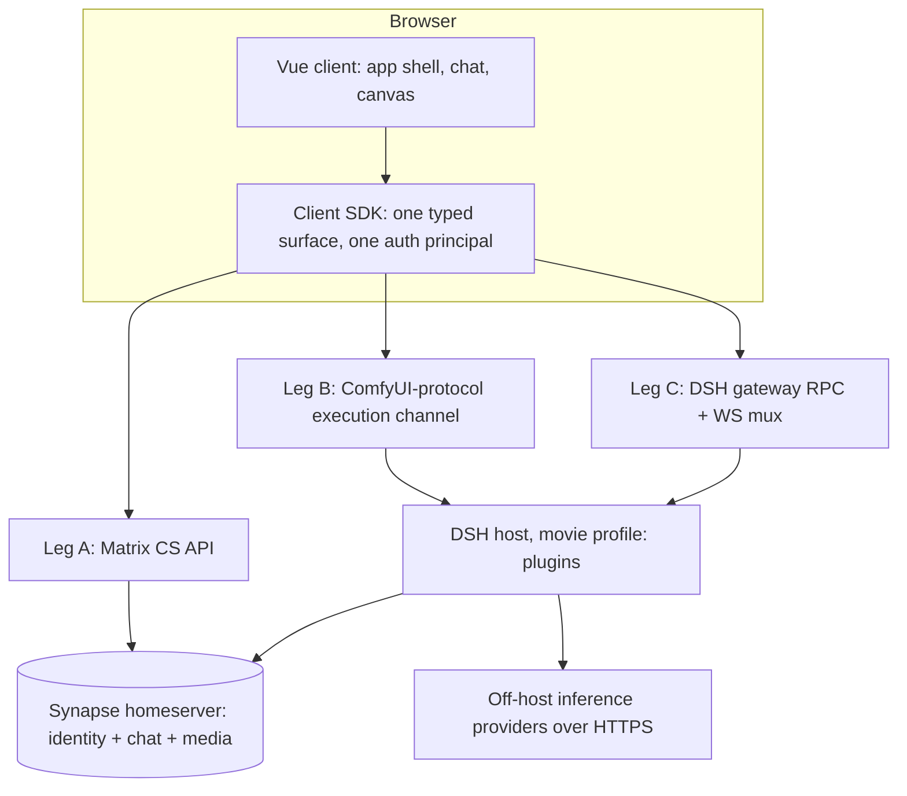
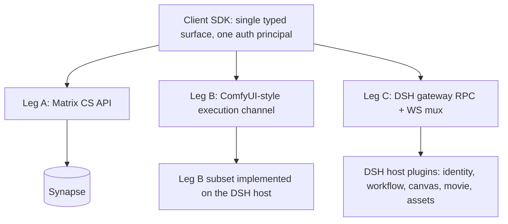
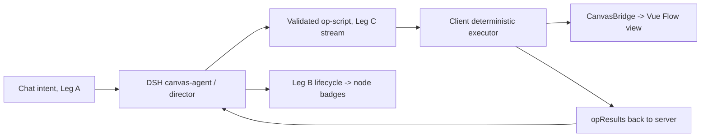

# dsh_movie System Architecture

- Nature: conceptual design and decision rationale — **not** an implementation or code-detail reference.
- Synthesizes the four phase design documents in `doc/design/` (`phase1-dsh-matrix-feasibility.md`, `phase2-client-and-protocol.md`, `phase3-comfyui-canvas-agent-scripting.md`, `phase4-vueflow-canvas-vidsay-shell.md`).
- Audience: a reader who wants to understand *why the system is shaped the way it is*, and the trade-offs behind its arguable choices.

## 0. At a glance

dsh_movie is a collaborative, chat-driven movie-production system. A browser client talks to a **DeepSeek Harness (DSH)** host that is built almost entirely out of plugins, with **Matrix/Synapse** as the single identity and chat authority and **all model inference delegated off-host**. Three communication "legs" carry every client↔server interaction behind one typed SDK.

The rest of this document expands the framing (plugins), then authentication, the three legs, the canvas, the session/governance model, the server and client loops, the movie pipeline, cross-cutting decisions, and the honest list of deferred gaps.

## 1. Framing: DSH/Cordis — everything is a plugin

DSH is built on the **Cordis plugin kernel**. The defining idea is that *there is no privileged core*: the agent loop, session log, tool registry, model adapters, identity, and gateway are all plugins. A plugin is an object that injects services and applies itself to a context; services claim stable keys (`ctx.sessions`, `ctx.llm`, `ctx.tools`, `ctx.credentials`, `ctx.subagents`, `ctx.jobs`, …); events are typed with dispatch modes; and every registration is a **reversible effect** (clean teardown on unload).

A running `dsh` is a **plugin tree composed at boot from ordered layers** — a *profile* stacks *bundles* plus `cordis.patch.yml` overrides plus out-of-tree plugins. dsh_movie defines a `movie` profile = `dsh-base` + our own plugins (`dsh-matrix-identity`, `dsh-matrix-chat`, `dsh-movie-gateway`).

**Why this matters conceptually:** it explains every downstream decision. Identity, chat transport, the canvas protocol, and the RPC gateway are not "features of a monolith" — they are independent plugins that can be added, replaced, or removed without touching a kernel. It also explains a recurring constraint: an **out-of-tree, run-from-source plugin cannot always use DSH's native generated surfaces** (see the `@Remote` fallback in §2 and §6). This single framing is the reason the system could adopt Synapse, ComfyUI's protocol, and a Vue canvas as *swappable adapters* rather than core rewrites.

## 2. Identity & authentication: Synapse as the sole authority

### 2.1 The identity gap and the inversion

DSH ships **no user-account subsystem** — its `identity` package provides only an anonymous per-installation correlation id. dsh_movie therefore does not build accounts; it **fills the gap with Synapse** (Matrix), adapted into a plugin.

This is a deliberate **inversion of vidsay**, where `better-auth` was the primary account store and Synapse a shadow. In dsh_movie, **Synapse is the only identity store** and better-auth is removed entirely. The decision: *no JavaScript "FastAPI-Users" equivalent is needed* — Synapse's Client-Server API + Admin API + `homeserver.yaml` policy already cover registration, login, password hashing/reset, email verification, user CRUD, and rate limiting; MAS/OIDC covers future SSO. The plugin does **only adaptation**: provisioning idempotency, token introspection/brokering, principal mapping, and events.

### 2.2 Where credentials live

| Field | Source of truth | Notes |
|---|---|---|
| User ID | Synapse | Matrix `@localpart:server`; UI shows bare localpart |
| Password | **Synapse only** | Hashed in Synapse's DB; **never leaves Synapse**, never stored by us |
| Nickname / Avatar | Synapse | `m.profile` (displayname, `mxc://` avatar); no duplicate profile store |
| Email | Synapse | `threepids`; enforced by homeserver policy |
| Secrets (admin token, brokered tokens) | DSH | `ctx.credentials` = `credentials-local` private YAML readable only by the same OS user; config holds **names, never values** |
| Product extras (quota/ownership/billing) | dsh_movie | Deferred; not part of the identity story |

Rejected alternatives for auth: (a) a DSH-native account store (re-implements hashing/reset/email and loses Matrix integration); (b) MAS/OIDC as the product IdP now (a valid *later* upgrade; the plugin seam is unchanged); (c) keeping Toonflow's better-auth (explicitly excluded).

### 2.3 Two authentication modes

- **Mode A (brokered):** client calls a login method; the plugin logs into Synapse, stores the brokered Matrix token as a credential, and returns an opaque DSH session token.
- **Mode B (direct — the default):** the **browser logs into Synapse itself** (matrix-js-sdk) and presents the **Matrix access token** with every DSH call; the host **introspects it via `whoami` (cached)** and maps the Matrix user to a principal `matrix:<mxid>`.

Mode B makes the browser the trust anchor and means there is **no second login and no JWT of our own** — one credential (the Matrix token) authenticates all three legs.

### 2.4 The `@Remote` fallback (an arguable decision)

DSH's native API surface is the **Typert `@Remote` gateway**: services mark methods `@Remote`/`@RemoteScope`, a build step generates strict Host/Client contracts, and calls flow over `POST /api/<ns>/<method>` + a multiplexed WebSocket, each naming a **Peer** principal, gated by `ctx.remoteAccess.decide()` role policies.

The catch: **native `@Remote` generation cannot be fed by an out-of-tree, run-from-source plugin** — the Connection client requires pre-generated `lib/typert.remote-client.*` artifacts and refuses to mount source (SRC) descriptors that lack strict codecs. dsh_movie therefore uses the documented **fallback**: a **plugin-owned `/auth/*` loopback HTTP listener** (port 8787). The browser presents its Matrix token; the host introspects it and maps it to a principal, and resolves the caller's **room role** (`host` / `member` / `none`, **fail-closed**). Production front-names this listener behind Caddy and tightens the allowed origin; **the endpoint contract stays the same**. This preserves Synapse as the sole identity authority and leaves the native-`@Remote` seam unchanged for a future upgrade.

### 2.5 Per-user isolation (server-side)

A Matrix user id maps to a DSH **Peer** + `@RemoteScope('user')` **scoped Context**, so sessions, workspaces, and agent inboxes are isolated per user; room host/member roles map to `ctx.remoteAccess` role policies. (This — not the browser cache — is the real isolation mechanism; see §7.3.)

## 3. Three legs, one SDK

Two questions drove the protocol design.

**Q1 — Do we need a direct client↔server channel in addition to Matrix chat?** Yes. Matrix's CS API is purpose-built for chat/rooms/media/presence, but is a poor fit for canvas control, agent steer/stop/approval, asset CRUD, registry manifests, and quota/billing. Those need a direct RPC/WS channel — **Leg C**.

**Q2 — Can Matrix + ComfyUI be unified into one protocol?** Feasible as a **composition**, but **not sufficient as a literal merge**. Matrix contributes identity/session/chat/media; ComfyUI contributes the workflow-graph interchange shape and the execution-lifecycle envelope. Neither covers agent control, asset CRUD + lineage, registry, workspace files, or quota — hence the third leg is **mandatory**.

**The key decision:** unification happens **at the client SDK layer, not on the wire.** One typed SDK (`client/sdk`) multiplexes three legs behind a single surface over shared contract types in the `protocol` package, with **one auth principal** (the Matrix token). Merging the wire protocols themselves would mean re-implementing Matrix sync/federation and ComfyUI execution semantics for no gain.

- **Leg A (Matrix CS API, matrix-js-sdk in browser):** login/whoami/refresh, room sync, messages/state, media upload + authenticated media download, presence/typing. The chat UI speaks this directly.
- **Leg B (ComfyUI-compatible):** graph interchange = **ComfyUI-style workflow JSON** (nodes/links/widget values); live channel = a **WS envelope mirroring ComfyUI message types** (`status`, `executing`, `progress`, `executed`, binary preview). The DSH host itself implements this protocol subset (**frontend-only ComfyUI — no Python server**). Because all inference is delegated off-host, the same envelope can also proxy a real ComfyUI API worker if one is ever run on a GPU server.
- **Leg C (DSH gateway RPC + WS mux):** `POST /api/<ns>/<method>` + a multiplexed WS for streams, one Matrix-token principal. Namespaces include `auth.*`, `workflow.*`, `workspace.*`, `canvas.*`, `movie.*`, `room.*`, `assets.*`, `registry.*`. Realized as a **plugin-owned loopback HTTP+WS gateway** (port 8788), not native Typert — for the same out-of-tree-plugin reason as §2.4. The wire contract is unchanged; only the hosting mechanism differs.

**Contract-as-code:** the `protocol` package is a shared TypeScript catalog (Leg B message set, Leg C interfaces, the bridge postMessage contract, the workflow-JSON schema, the op-script catalog, and the movie-step node-schema registry). It is imported by **both** client and server and contains **no runtime proxies** — a single source of truth.

## 4. The canvas: from ComfyUI iframe to Vue Flow (Path B)

The canvas has the most interesting evolutionary arc in the system, and it demonstrates the value of designing for a **seam**.

### 4.1 Frontend-only ComfyUI, no Python server

The original approach (adopted at the Phase-2 decision gate) embedded the **unmodified ComfyUI frontend build** (pinned version) in an `<iframe>`, served same-origin by our own host. There is **no Python ComfyUI server**: the DSH host implements the minimal backend protocol subset the frontend demands (`/object_info` generated from our movie-step node schemas, `/system_stats`, `/extensions`, `WS /ws`, `/userdata` mapped onto the Leg C workflow store, plus no-op/forwarded `/queue|/history|/prompt`). ComfyUI is a **pure editor/visualizer** — its `/prompt` queue is accepted but never executed natively; execution lifecycle events are emitted by our own executor as ComfyUI WS messages and painted as node status badges.

**Licensing boundary:** ComfyUI core/frontend are **GPL-3.0**. The iframe embeds the unmodified build served as static assets — **no ComfyUI code is vendored or copied into our bundle**, so there is no license contamination.

### 4.2 Why it was later replaced (Phase 4, Path B)

Phase 4 **replaced the ComfyUI iframe with an in-app Vue Flow canvas**, taking the pre-planned fallback from the risk table. Rationale: full typing and branding control, no untyped/version-fragile `postMessage` surface, and no dependency on ComfyUI frontend API churn. Crucially this is **Path B — client-only**: the three backend legs (Leg A chat, Leg B execution + status, Leg C server-authoritative `WorkflowGraph`) are **unchanged**. Only the canvas *view* and the app *shell* were ported.

### 4.3 The `CanvasBridge` seam (the whole trick)

`useCanvasBridge.ts` defined a **`CanvasBridge` interface** (`loadWorkflow`, `exportGraph`, `setNodeStatus`, `setReadonly`, `viewFit`, `request`, `sendCommand`, `whenReady`, and event hooks). Phase 4 added `useVueFlowBridge.ts` implementing the **same interface** over a Vue Flow store + a graph mapper. Because the seam is an interface, **every downstream consumer works unchanged**: the op-script executor, the Leg B execution-status watcher, the Leg C persistence/governance composables, the room-role composable, and the movie-run composable. No protocol, op-catalog, postcondition, or gateway change.

### 4.4 Graph model: server-authoritative ComfyUI graph

The **ComfyUI `WorkflowGraph` stays server-authoritative** — it is the persisted and executed shape. The Vue Flow graph `{nodes, edges, viewport}` is **only the client view model**, translated by a **bidirectional mapper**. The alternative ("persist Vue Flow natively") was **rejected** because it would force a protocol + governance re-do for no backend benefit.

Two further decisions:
- **Static nodes, not runtime plugins.** vidsay loads node types as UMD runtime plugins; dsh_movie ships **one generic node component** mapped to all six movie-step class types, fully **data-driven off each node's schema** (widget editors, per-slot input/output handles, status badges).
- **Leg B badge paint rewiring.** With the iframe's internal WS gone, the parent-side Leg B socket now drives node badges. Status paint is **view-only** (never serialized into the `WorkflowGraph`), so the bridge suppresses the graph-dirty tick briefly after a badge paint to avoid spurious autosave/revision bumps.

## 5. Session model & graph governance

### 5.1 One session = one room = one agent inbox = one workspace

The unit of the system is the **Matrix room**:

> one session = one chatroom = one per-room serialized DSH agent inbox (surfaced as the client chatbox) = one per-room workspace directory on the host.

A nuance on "one agent": the relayed room inbox feeds a **DSH Cordis agent**, and the room is the boundary of isolation and serialization (messages are processed one at a time per room). In practice several server-side agents may act within a room's scope — the chat relay, the **canvas-agent** (chat→op-script), and the **movie director** (§8) — but they all operate on that room's single workspace and graph authority.

### 5.2 Host-exclusive writes (single writer by construction)

The committed graph lives in a **per-room, file-backed workspace store** on the host (Leg C). Exactly one member is the room **host** — the single user at or above `HOST_POWER_LEVEL = 100` in `m.room.power_levels` (tie-broken by mxid, creator fallback), **resolved server-side on every request**.

**Only the host may write.** A member's graph-mutating call (`canvas/script`, `workspace/draft.*`/`undo`/`redo`/`commit`/`revert`, `workflow/put`) is rejected `forbidden`; members receive the **read-only converged HEAD** via `workflow/get` plus a live `workflow/watch` snapshot. This deliberately replaces an earlier "stale writer re-bases / clobbers" model: **with one writer there is no concurrent-merge problem to solve** — no CRDT, no rebase, no conflict resolution.

**Host transfer:** `room/transferHost` edits `m.room.power_levels` **signed with the acting host's own token** — the successor is raised to 100, every prior holder demoted to 50 — then fans a `{stage:'role'}` frame to all watchers so the old host flips to read-only **live**.

### 5.3 Version control: full snapshots, no diff

The host's uncommitted working graph is a server-side **draft** with an **undo/redo stack**. **Commit** appends the current graph as a **FULL snapshot** to a GitHub-style **append-only history** (rev N+1); **revert** re-applies a prior snapshot as a **new forward commit**. Committed revisions are **immutable**; history is **never rewritten**. There is **no diffing** — each commit is a whole-graph snapshot file.

**Why full snapshots are the right call here:** because writes are host-exclusive (§5.2), there is no merge/rebase need, so the simplest correct model — a whole-graph snapshot — wins. The trade-off (storage cost, no deltas) is acceptable at this scale; a 200-node commit/read-back/watch round-trip measured ~19ms.

### 5.4 Live convergence

Every draft/commit/transfer broadcasts over the `workflow/watch` mux channel (`{stage: 'snapshot' | 'committed' | 'draft' | 'role', …}`). The **snapshot frame is always sent on subscribe** (even for an empty room, where HEAD is null) so a late subscriber anchors before any commit broadcast it must not miss.

### 5.5 Durability scoping (honest boundaries)

- Committed history is **file-backed** and survives reloads and multiple clients.
- The **live workflow store is intentionally volatile** — it survives across clients/reloads but **resets on a gateway restart**.
- **Durable Matrix room-state consensus is deferred**: the host seat is resolved from power levels *on demand* rather than persisted as a governance event.
- Members currently see the **committed HEAD + role**, not the host's *uncommitted* draft.

## 6. Server side: agent loop, HTTP engine, CPU-only host

### 6.1 No pi-coding agent — DSH's native Cordis loop

dsh_movie uses **DSH's native Cordis agent loop**, *not* a pi-coding agent (pi belongs to the abandoned Toonflow stack). The **intelligent supervision** — observe → re-plan → act — stays **server-side**: the canvas-agent evaluates `opResults` + Leg B execution events against the step rubric and issues fix-up op-scripts (capped re-plans per transaction). The evaluate/iterate loop runs where the model and the skills live.

### 6.2 The HTTP engine

DSH's own web engine, `@deepseek-ai/dsh-host-webserver`, is built directly on **Node's `node:http`** (upgrading to `node:https` when TLS is configured), with **`ws`** for WebSocket upgrades, a Fetch-style request handler, and fixed route matching (exact → longest-prefix → fallback). It serves browsers only and holds no files itself — plugins register their routes.

dsh_movie follows the **same engine choice** for its custom legs, but does **not** front them with `dsh-host-webserver`/native Typert. As established in §2.4, an out-of-tree from-source plugin cannot bind the native `@Remote` surface, so dsh_movie runs **plugin-owned loopback HTTP+WS gateways on Node `http` + `ws`**: the identity `/auth` listener (8787) and the movie gateway (8788, Leg C dispatcher + `/api/ws` mux + the Leg B ComfyUI-protocol subset). Production places these behind Caddy; the contracts are unchanged.

### 6.3 CPU-only host, inference delegated off-host

A central decision: the **DSH host runs zero Python and zero model code.** All inference — text, image, video — is **delegated off-host over HTTPS** to OpenAI-compatible (or provider-native) endpoints (a cloud provider such as Bailian, or a self-hosted service on the company GPU server inside the firewall), reached through DSH `ctx.llm` / `ctx.credentials`. A `MediaProvider` seam abstracts this; today only a **canned** media provider ships because the wired LLM (Bailian) is chat-only. The host is pure orchestration: queue = `ctx.jobs`, progress = the Leg B emitter.

### 6.4 Orchestration primitives

The director runs on **`ctx.subagents` + `ctx.jobs`** (§8). The shared task-DAG board `ctx.agentTeams` is **deliberately not used** — in the pinned DSH version it lives in an experimental bundle that also disables standard subagent tools and injects experimental UI globally. To keep the host composition stable, the step DAG is held in **gateway-owned pipeline state** instead. `ctx.jobs` requires an attached controller, so the gateway attaches one for its lifetime and detaches on teardown.

**Durable server state** = append-only session logs + credentials YAML + revision-gated per-room file stores. Phase 1 deliberately runs **no relational DB**; a separate Postgres schema (asset lineage/billing/ownership) is a later concern, and Synapse's schema is never shared or touched.

## 7. Client side: deterministic executor, supervision split, per-user cache

### 7.1 No pi-core in the browser

Running an in-browser LLM agent loop (pi-core, as Toonflow's canvas did) is **technically feasible but rejected** for four reasons:
1. It re-imports the pi/Toonflow stack we deliberately abandoned.
2. An in-browser LLM loop needs server-proxied model keys plus duplicated prompt/skill infrastructure for no gain, since every decision still needs server context.
3. The supervision required here is **deterministic verification**, which a small transactional executor does more reliably and testably than an LLM loop.
4. Stack unity: DSH's own `sdk`/web profile is the sanctioned path if a genuine in-browser agentic feature ever appears.

### 7.2 The deterministic executor/verifier loop

The client's "loop" is a **deterministic, LLM-free transactional executor**:

> receive `canvasScript{txnId, ops}` over a Leg C stream → snapshot the graph → apply ops through the bridge → check postconditions (node exists, edge connected, widget value, status painted) → retry with capped-exponential backoff on transient bridge errors → **rollback to the snapshot on hard failure** → stream `opResults` back to the server.

The server agent emits a **constrained op-script** (a JSON op sequence over the command catalog), **never eval-able arbitrary JavaScript** — this avoids executing untrusted/LLM-hallucinated code in the user's browser, keeps transactions verifiable, and makes replays/diffs testable. The result is a clean **supervision split**: *deterministic verification on the client, intelligent re-planning on the server.*

### 7.3 Per-user client cache/state (simple)

The browser persists a small amount of state in `localStorage`; this is a **persistence convenience, not an isolation mechanism**:

- **Settings:** one self-contained blob (key `dsh-movie.settings`) with **no server round-trip** — theme, language, primary color, font scale, radius. Individual Pinia stores persist *inside* this blob via a custom storage adapter, so top-level keys are not scattered.
- **Auth:** only the **Matrix half-session** is persisted (key `dsh-movie.auth`, picking just `session`). On reload, `restore()` re-verifies the token via `whoami`; a lighter `revalidate()` runs on tab-focus/visibility and a periodic timer, and **a network blip is not treated as a dead token**.
- **Ephemeral in-memory caches:** the avatar `mxc://` is resolved to a **blob URL held in memory** (not persisted); chat media uses object URLs.

**Honest caveat:** these keys are **not namespaced per user** — there is one active session per browser profile, and switching accounts overwrites the same keys. Genuine per-user isolation lives **server-side** (`@RemoteScope('user')` scoped Contexts + per-user workspace roots, §2.5). So the client "cache" is best described as a short tutorial in browser state persistence, not a security boundary.

## 8. The movie pipeline: what the system actually produces

The product domain is a **six-step movie production pipeline**. The six steps are node class types in a shared registry (`MOVIE_NODES`) that simultaneously feeds the ComfyUI `/object_info`, the graph validator, and the canvas node palette:

1. **MovieScript** — the literary script (text).
2. **MovieShotPlan** — the shot breakdown (text).
3. **MovieAsset** — character/scene assets (media).
4. **MovieStoryboard** — storyboard frames (media).
5. **MovieClip** — generated clips (media).
6. **MovieAssemble** — the assembled movie (media).

### 8.1 The director

A **per-room serialized `MovieDirector`** creates a director agent and runs the six steps **in order**:
- The **two text steps** (script, shot plan) run as **real spawned subagents** (`ctx.subagents`), each artifact fed into the next step's prompt.
- The **four media steps** run through the **canned provider** (Bailian is chat-only; the real GPU/provider seam exists but only the canned impl ships).

It emits **incremental pipeline-status stages**; an upstream failure **short-circuits dependents to `skipped`**. Gateway surface: `POST /api/movie/run` (role-gated) returns `{runId, accepted}`; the `movie/run` mux channel re-authenticates, **replays progress-so-far**, then fans `{stage:'step'}` → `{stage:'done'}` → `end`; `POST /api/movie/status` reads the last pipeline.

### 8.2 The Leg B executor

When a graph is run, the executor performs: **registry** lookup (merge the six movie nodes into `/object_info`) → **validation** (ComfyUI-shaped `node_errors`: unknown class type, unknown node keys, link to a missing node, out-of-range source slot) → **topological sort** (Kahn + cycle detection) → a **runner** that registers one job and walks nodes in topo order, emitting the Leg B lifecycle (`executing → progress → executed → execution_success`; `execution_error`/`execution_interrupted` on failure/abort) over the shared broadcast.

### 8.3 Chat-driven canvas scripting

The user "directs" the graph **conversationally**: a chat intent → the DSH canvas-agent analyzes intent → emits a **validated op-script** → streamed to the client executor (§7.2) → applied through the bridge → `opResults` streamed back → the server **evaluates and re-plans** if ops failed. Each pipeline step also **paints its canvas node badge** by reusing the Leg B status-paint semantics, so the user watches the graph light up step by step.

## 9. Cross-cutting decisions

### 9.1 vidsay port strategy (Path B) and stubs

The UI is **copy-pasted from vidsay** (a read-only source, never modified), then adapted. Ported: the **app shell** (left icon rail + top bar), the **chat UI skin** (wired to dsh_movie's Leg A data layer, not vidsay stores), the **language picker**, the **theme system**, and the **canvas view**. The guiding principle is **"port, not vendor"**: the canvas was rebuilt natively on `@vue-flow/core` rather than vendoring vidsay's 13 `@toonflow/*` packages (avoiding a Bun→pnpm reconciliation risk), while `i18n` *was* vendored as `@dsh-movie/i18n`.

Most vidsay **SaaS/pi surfaces were never ported** (MCP control, single-agent dialog, agent cloud, plugin market, provider billing, local models, anonymous data) — there is nothing to call and no route to render. The only SaaS surfaces present are the account page's **Wallet** and **Billing** sections, which are intentionally **"coming soon" text stubs with no backend calls**.

### 9.2 Licensing as an architecture driver

- **DSH** — MIT (attribution retained).
- **vidsay** — same owner; copied as a read-only source.
- **ComfyUI** — GPL-3.0, **embedded via iframe only, never vendored/copied** → no contamination. (After Phase 4 the ComfyUI frontend is no longer even embedded; only its **protocol** survives as Leg B.)

### 9.3 Per-user isolation & principal mapping

Restated as a cross-cutting concern: a Matrix mxid → a DSH **Peer** → a `@RemoteScope('user')` **scoped Context** → a **per-user workspace root**; the room role (`host`/`member`/`none`, fail-closed) is resolved through `ctx.remoteAccess`. This is the actual isolation boundary — the browser cache (§7.3) is not.

### 9.4 Contract-as-code

A single `protocol` package is the **single source of truth** for all three legs, the workflow-JSON schema, the op-script catalog, and the node-schema registry — imported by client and server, with no runtime proxies. This is what keeps the three legs and both canvas implementations swappable.

## 10. Deferred / honest gaps

The system is deliberately scoped; the following are **known, documented deferrals**, not oversights:

- **Durable Matrix room-state consensus** for the host seat (currently resolved from power levels on demand, not persisted as a governance event).
- **Live member draft-sharing** (members see committed HEAD + role only, not the host's uncommitted draft).
- **Structured/graph diffing** (history stores whole snapshots, not deltas).
- **Real GPU/provider-API media inference** (the `MediaProvider` seam exists; only the canned impl ships, because the wired LLM is chat-only).
- **Executing non-movie node types via Leg B** (render-only until a later milestone).
- **Volatile live workflow store** (resets on a gateway restart; committed history is durable).
- **SaaS backends** — wallet, billing, quota, plugin market, MCP, single-agent — **stubbed or not ported**.

These gaps are consistent with the framing in §1: because everything is a plugin behind stable contracts, each can be added later without reshaping the kernel, the protocol, or the canvas seam.
