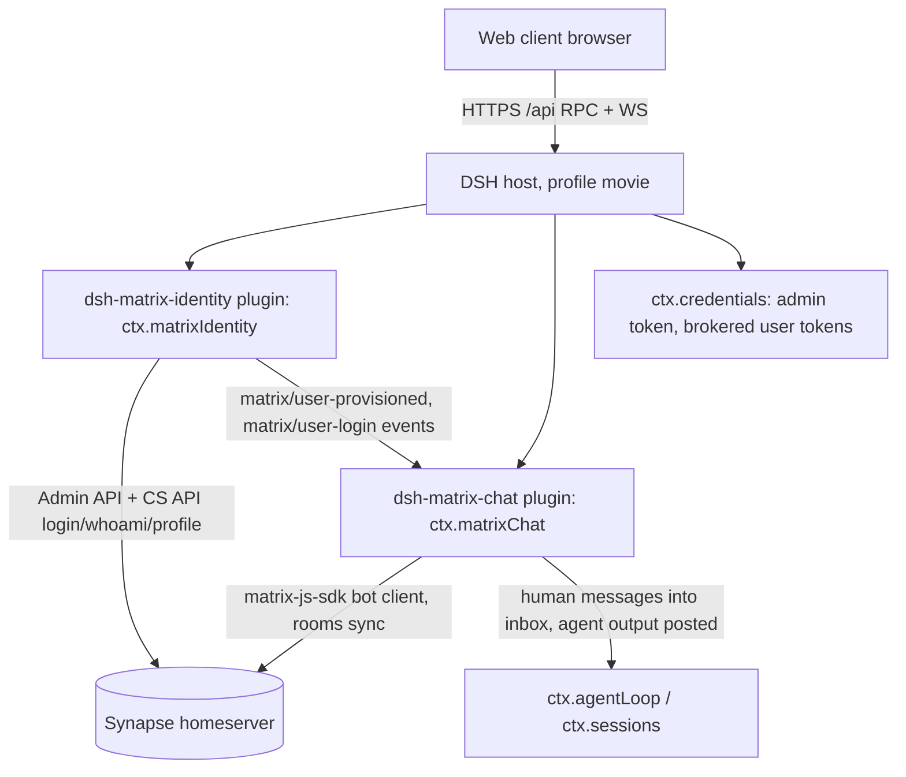

# Phase 1 Feasibility: DSH + Matrix/Synapse Server-Side Integration

- Status: Phase 1 implemented and verified (M0–M4 complete); see §9 build outcomes
- Date of outcomes: 2026-08-09
- Scope: brand-new movie-making server built on DeepSeek Harness (DSH); Toonflow server-side abandoned; Synapse as identity provider adapted into a DSH plugin
- Sources studied: `/home/robot/deepseek-harness` (cloned, MIT license), `/home/robot/vidsay` (read-only copy-paste source, never modified)

## 1. Goals and constraints

1. Build the new server from scratch in `/home/robot/dsh_movie/server` on top of DSH (`deepseek-harness`, MIT-licensed, pnpm/Node).
2. Do NOT reuse Toonflow's account management / authentication (better-auth). Instead convert Matrix/Synapse account management and authentication into a DSH plugin.
3. `/home/robot/vidsay` is a read-only copy-paste source only; its source code must never change.
4. All design documents live in `/home/robot/dsh_movie/doc/design/`.
5. Phase 1 = feasibility + prototype of DSH ↔ Synapse integration (identity plugin + chat transport plugin). The movie pipeline (director/sub-agents, asset repository, canvas graph) is Phase 2+.

## 2. What DSH actually provides (from the cloned repo)

- **Cordis plugin kernel** (`docs/cordis-primer.md`): a plugin is an object implementing `Service` (`inject` + `apply(ctx)`); services claim stable keys (`ctx.tools`, `ctx.llm`, `ctx.sessions`, …); typed events with dispatch modes (`emit/waterfall/parallel/serial/bail`); all registrations are reversible effects. *Every part of the product is a plugin*, including the agent loop, session log, tool registry and model adapters — there is no privileged core.
- **Profiles / bundles / patches** (`docs/architecture.md`): a running `dsh` is a plugin tree composed at boot from ordered layers; shipped profiles `web | headless | sdk | sdk-minimal | acp`; custom composition = new profile + ordered bundles + `cordis.patch.yml` + out-of-tree plugins installed via `dsh plugin`. Our server will define a `movie` profile stacking `dsh-base` plus our own bundles.
- **Core services**: `ctx.sessions` (append-only durable `SessionEvent` log), `ctx.agents` / `ctx.agentLoop` (turn/step driver), `ctx.tools` (guarded tool pipeline), `ctx.llm` (adapter seam), `ctx.subagent`, `ctx.team`, `ctx.workflow` packages exist for later pipeline stages.
- **Credentials** (`packages/credentials`): `ctx.credentials` stores/looks up/removes secrets by *name* (config never embeds values); `credentials-local` = private on-machine YAML readable only by the same OS user; `ctx.authorization` = plugin-owned flows that obtain a credential by asking a human. Perfect home for the Synapse admin token and brokered user tokens.
- **Identity gap**: `packages/identity` only provides an anonymous per-installation correlation id. DSH has **no user-account subsystem** — confirming the gap our plugin must fill (by adapting Synapse, not by re-implementing accounts).
- **API gateway (Typert)** (`docs/api-gateway.md`): business services expose `@Remote` / `@RemoteScope(key)` methods to web clients over the Connection RPC (`POST /api/<ns>/<method>` + multiplexed WS for streams). Every call names a **Peer** principal; for non-owner peers the gateway resolves touched resources and asks `ctx.remoteAccess.decide()` (role-based policies registered by business packages). `@RemoteScope` resolves identities to **scoped Contexts** — the seam for per-user isolation. Connection owns the unified `/api` trust check.
- **Runtime**: Node + pnpm workspace, tsdown builds, vitest; Python SDK launches `dsh --profile sdk`. (Vidsay snippets are Bun/TS — adaptation needed, see §6.)

## 3. Target Phase-1 architecture

- The DSH host runs as a long-running supervisor process (state continuity), headless subprocesses reserved for isolated heavy rounds (existing precedent).
- Synapse stays the only authority for account data (passwords, devices, profiles); DSH never stores passwords.
- Phase 2+ adds `dsh-comfyui-protocol` (Leg B: the minimal ComfyUI backend protocol subset served by the DSH host, see Phase 3 §2), `dsh-movie-pipeline` (director + step sub-agents via `ctx.subagent`/`ctx.team`), `dsh-media` (ffmpeg/provider proxying — all inference off-host over HTTPS), asset repository, and the canvas graph client. The DSH host itself never runs Python or model code.

## 4. Account management & authentication as a DSH plugin

**Decision: Synapse is the identity provider; the plugin is the adaptation layer.** Rejected alternatives: (a) DSH-native account store — re-implements hashing/reset/email and loses Matrix integration; (b) MAS/OIDC as product IdP — valid later upgrade, plugin seam unchanged; (c) keeping Toonflow better-auth — explicitly excluded.

Plugin `dsh-matrix-identity` responsibilities (Cordis service key `ctx.matrixIdentity`):

1. **Provisioning**: idempotent user creation via Synapse Admin API (pattern copied from vidsay provisioning); disable/erase on account closure; password reset delegation.
2. **Authentication modes** (both supported, mode B default for Phase 1):
   - Mode A (brokered): client calls `@Remote auth/login`; plugin logs into Synapse CS API, stores the brokered Matrix token as a `CredentialRef`, returns an opaque DSH session token.
   - Mode B (direct): web client logs into Synapse itself via matrix-js-sdk and presents the Matrix access token with every DSH Remote call; plugin introspects via `whoami` (cached) and maps the Matrix user to a Peer principal.
3. **Principal mapping**: Matrix user id → DSH Peer + `@RemoteScope('user')` scoped Context, so sessions, workspaces and agent inboxes are isolated per user; room host/member roles map to `ctx.remoteAccess` role policies.
4. **Secrets**: Synapse admin registration token and any brokered tokens live in `ctx.credentials` (credentials-local private YAML); config names only references.
5. **Events**: typed `matrix/user-provisioned`, `matrix/user-login`, `matrix/profile-changed` for other plugins (chat transport joins/invites on provision).
6. **Profile sync**: display name/avatar read from Matrix `m.profile` (single source of truth), no duplicate profile store.

Why this fits DSH philosophy: the plugin is a thin wrapper over Synapse's stable Admin/CS APIs (kernel-vs-plugin boundary: no domain logic duplicated in the harness), uses the native secrets store, and exposes product auth through the native `@Remote` surface with native peer/role policy.

### 4.1 Profile-field storage, database choice, account-library decision

Storage map (Synapse is the only identity store; inversion of vidsay where better-auth was primary and Synapse shadow):

| Field | Source of truth | Physical storage |
|---|---|---|
| User ID | Synapse | Matrix user id `@localpart:server`; product UI shows bare localpart |
| Password | Synapse only | Hashed in Synapse DB `users` table; never leaves Synapse |
| Nickname | Synapse | `m.profile` displayname (`profiles` table + room member-state copies) |
| Avatar | Synapse | `avatar_url` (mxc://) in profile; bytes in Synapse on-disk media store |
| Email | Synapse | `threepids` table; enforce via `registrations_require_3pid: [email]`; SMTP in `homeserver.yaml` |
| Product extras (quota/ownership/billing) | dsh_movie server | Phase 1: none or per-user JSON; Phase 2: own Postgres schema |
| Secrets (admin token, brokered tokens) | DSH | `ctx.credentials` private YAML (credentials-local) |

Database decisions:

1. **Synapse backend**: Synapse bundles no database server — we provide it: SQLite (embedded, zero-install, single-process only) for dev; self-provisioned PostgreSQL for production (vidsay deployment precedent: `drone-pg.service`). The dev→product switch is a one-way migration via Synapse's `synapse_port_db` script, not a config flip; production otherwise starts fresh.
2. **DSH server Phase 1**: no relational DB and no PostgreSQL installation — durable state = append-only session logs, credentials YAML, revision-gated per-room JSON stores.
3. **Phase 2+**: separate database in the same Postgres cluster for asset lineage/billing/ownership; Synapse's schema is never shared or touched.

Account-library decision: **no JavaScript FastAPI-Users equivalent is needed.** Synapse CS API + Admin API + `homeserver.yaml` policy cover registration, login, password hashing/reset, email verification, user CRUD and rate limiting; MAS/OIDC covers future SSO. The plugin implements only adaptation (provisioning idempotency, token introspection/brokering, principal mapping, events) — no password handling, JWT signing, or email sending on our side. A home-grown account module is revisited only if non-Matrix product identities become required; prefer Synapse profile/account-data extensions first.

## 5. Matrix chat transport plugin and vidsay copy-paste inventory

Plugin `dsh-matrix-chat`: long-lived matrix-js-sdk bot client (room sync, presence), relays human room messages into DSH agent inboxes (serialized per room), posts agent output as `m.text / m.image / m.video / m.file` with `m.mentions`; owns reconnect/backoff and token refresh as reversible effects.

Copy-paste candidates from `/home/robot/vidsay` (read-only):

- `apps/server/src/matrix/bot.ts` — bot client lifecycle, command routing, degrade-never-break.
- `apps/server/src/matrix/roomPost.ts` — posting m.text/m.image/m.video/m.file with mentions.
- `apps/server/src/matrix/agentWorkspace.ts` — per-room workspace + revision-gated workflow store (Phase 2).
- `apps/server/src/matrix/{grants,settings,trigger}.ts` — consent grants, per-room model settings, video trigger (Phase 2).
- `apps/server/src/routes/matrix/{token,agent,status,generate}.ts` — token brokering, provisioning endpoints, status.
- matrix-js-sdk v42 quirks memo: `sendEvent` must be `.bind(client)`; no `client.sendText`; use `RoomStateEvent.Update` for power-level changes; strict event-content unions need bound-and-cast helpers.
- Provisioning idempotency pattern (already-joined → skip, not error).

Explicitly NOT copied: pi-coding runtime (`agent/runtime/*`), room responder brain, better-auth account routes, singleAgent SSE loop, Toonflow plugin market.

Adaptation notes: Express route handlers → Cordis service methods + `@Remote`; Bun APIs (`Bun.serve`, `Bun.file`) → Node equivalents; TS strictness aligned to DSH tsconfig base.

## 6. Feasibility verdicts and risk register

| Concern | Verdict | Notes / mitigation |
|---|---|---|
| Synapse auth/account as DSH plugin | Feasible | Service + `@Remote` + `ctx.credentials` + typed events cover every need; no kernel changes |
| Multi-user remote web trust | Resolved (M3/M4) | Native `@Remote`/Typert generation is impractical for an out-of-tree from-source (tsx) plugin — the Connection Client requires pre-generated `lib/typert.remote-client.*` artifacts and refuses to mount SRC descriptors lacking strict codecs. Implemented the documented fallback instead: a plugin-owned `/auth/*` loopback HTTP listener. The browser logs into Synapse directly (Mode B) and presents its Matrix access token; the host introspects it via `whoami` and maps it to principal `matrix:<mxid>`, and resolves room role via `/auth/role`. Verified end-to-end by script (`verify:principal`, `verify:two-user`) and in a real browser login, for two distinct users with `host`/`member`/`none` roles. Production front-names the listener behind Caddy and tightens the allowed origin; the endpoint contract stays the same |
| Long-lived Matrix client in host | Feasible | Plugin service with effects; reconnect/backoff owned by plugin; supervisor restart resumes sessions from durable log |
| Secrets handling | Feasible | `credentials-local` private YAML, OS-user isolation; config holds names only |
| Runtime mismatch (Bun→Node) | Manageable | matrix-js-sdk runtime-agnostic; replace Bun-specific APIs; pnpm workspace |
| Per-user isolation | Feasible | `@RemoteScope('user')` scoped Contexts + per-user workspace roots |
| Licensing | OK | DSH MIT (retain attribution); vidsay code same-owner |
| E2EE | Out of scope | Plaintext rooms for server bot, as today |
| Synapse API drift | Low | Pin homeserver version; provisioning idempotent; admin API stable |
| DSH upgrade churn | Medium | Vendor-pin the cloned revision; out-of-tree plugins only, patch layers for upgrades |

## 7. Phase-1 milestones

- **M0 skeleton**: `dsh_movie/server` pnpm workspace consuming the pinned `dsh` SDK; `movie` profile (dsh-base + plugin rows); boots `headless` and `web`; typecheck green.
- **M1 identity plugin**: provisioning idempotency, login/whoami introspection, credentials storage, peer/scope mapping; headless tests against local Synapse; resolve the web trust-boundary open question.
- **M2 chat plugin**: bot joins provisioned rooms; human message → agent inbox → reply posted; per-room serialization; reconnect tests.
- **M3 minimal web client**: login + one room view (matrix-js-sdk direct for chat, DSH Remote for agent actions); verify principal path end-to-end.
- **M4 hardening**: token rotation, role policies (`host` vs `member`), two-user E2E, design-doc update; then Phase 2 kickoff (browser client + three-leg protocol; the director pipeline teams are built later, at Phase 3 P3-M4).

## 8. Repository conventions

- Layout: `dsh_movie/{protocol, server, client/web, client/sdk, doc/design}` — pnpm workspace members.
- Code: `/home/robot/dsh_movie/server/plugins/dsh-matrix-identity|dsh-matrix-chat`, profile under `server/profiles/movie`.
- Protocol: `/home/robot/dsh_movie/protocol` — shared TypeScript contract package (no runtime proxies): Leg B message catalog + boot subset, Leg C `@Remote` interfaces, bridge postMessage contract, workflow-JSON schema, op-script catalog, movie-step node-schema registry. Imported by both client and server; contract-as-code, single source of truth.
- Client: `/home/robot/dsh_movie/client/web` (Vue3 app) + `client/sdk` (three-leg multiplexer, imports `protocol`).
- Docs: `doc/design/` only; decisions recorded as dated markdown files; no design doc outside `doc/design/`.

## 9. Phase-1 build outcomes (2026-08-09)

All five milestones are implemented and verified against the live local Synapse (`server_name=localhost`, `127.0.0.1:8008`). Verification is by Node strip-mode smoke tests and dev scripts under `server/` (no test framework dependency), each printing `PASS`/`FAIL` lines and exiting non-zero on any failure.

| Milestone | Outcome | Evidence |
|---|---|---|
| M0 skeleton | `dsh_movie/server` pnpm workspace consuming `@deepseek-ai/dsh@0.2.2-rc.1`; `movie` profile (dsh-base + plugin rows via `cordis.patch.yml`) boots both `web` (GUI `:3080`) and `headless`; Bailian LLM wired; typecheck green | `pnpm dump:config`, `pnpm start:web`, `pnpm start:headless`, `pnpm typecheck` |
| M1 identity plugin | `dsh-matrix-identity` provides `ctx.matrixIdentity`: idempotent provisioning, `brokerToken`/`login`, cached `whoami`, stable `principalId` (`matrix:<mxid>`), `syncProfile`; typed events; degrade-never-throw | `pnpm test:matrix` (all M1 identity checks) |
| M2 chat plugin | `dsh-matrix-chat` provides `ctx.matrixChat`: matrix-js-sdk bot joins/auto-accepts invites, relays human room messages into a per-room serialized DSH agent inbox, posts replies with mentions, owns reconnect/backoff; echo-loop suppressed | `pnpm test:matrix-chat` (20 checks incl. peak-concurrency=1 serialization) + in-host live `/sync` loop |
| M3 minimal web client | Vue3+Vite client at `client/web`: logs into Synapse directly (Mode B), proves the principal against the host `/auth/principal`, opens one room, sends/receives messages. Host trust anchor = plugin-owned `/auth/*` loopback listener (`principalListenerPort`) | `pnpm verify:principal` (7 checks) + browser E2E (login → principal `matrix:@movie_demo:localhost` → real agent reply) |
| M4 hardening | Room role policy `roomRole()` (creator=`host`, joined=`member`, else=`none`, fail-closed) exposed over `/auth/role`; token rotation proven live per-op (no reload); two-user E2E with distinct principals + roles + deterministic relay; design doc updated (this §9, §6 row resolved) | `pnpm test:matrix-rotation` (all rotation checks) + `pnpm verify:two-user` (12 checks) |

Key resolution — browser→host trust (§6 "Multi-user remote web trust"): the native Typert `@Remote` generation pipeline cannot be fed by an out-of-tree from-source plugin, so Phase 1 uses the documented fallback — a plugin-owned `/auth/*` HTTP listener owned as a reversible effect. The browser authenticates to Synapse itself and presents its Matrix token; the host introspects it (`whoami`) and maps it to a DSH principal, and resolves the caller's room role. This keeps Synapse as the sole identity authority and leaves the Phase-2 seam (native `@Remote` + `ctx.remoteAccess.decide()` role policies keyed on `host`) unchanged.

Phase-1 dev artifacts (local Synapse only, non-secret throwaway accounts): seed/verify scripts under `server/scripts/` (`seed-demo.ts`, `verify-principal.ts`, `verify-two-user.ts`); the Vue client under `client/web`. Full `ctx.remoteAccess.decide()` integration and the movie pipeline (director/sub-agents, asset repository, canvas graph) remain Phase 2+.
