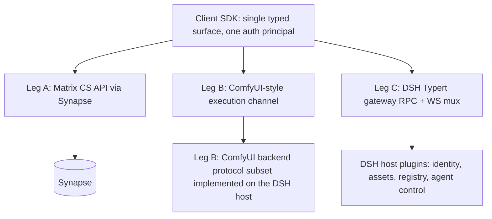

# Phase 2 Plan: Browser Client & Client–Server Communication Protocol

- Status: proposal for discussion
- Depends on: `phase1-dsh-matrix-feasibility.md` (identity plugin, chat transport plugin, DSH `movie` profile)
- Scope: unified client–server protocol, canvas strategy (ComfyUI iframe exploration), and copy-paste porting of vidsay client pages into `/home/robot/dsh_movie/client`
- Source: `/home/robot/vidsay` read-only copy-paste source; never modified

## 1. Questions answered

**Q1 — Do we need a direct client↔server channel in addition to Matrix chat?**
Yes. Matrix CS API is purpose-built for chat/rooms/media/presence and (optionally) room-scoped graph consensus, but it is a poor fit for workflow-canvas control, agent steer/stop/approval, asset-repository CRUD, registry manifests and quota/billing. Those need a direct RPC/WS channel to the DSH host. Confirmed in this plan as "Leg C".

**Q2 — Is combining Matrix/Synapse + ComfyUI protocols into one unified protocol feasible and sufficient?**
Feasible as a *composition*, **not sufficient as a literal merge**:
- Matrix contributes: identity/session, chat sync, room state/messages, media repository, presence/receipts; optionally room-scoped workflow-graph consensus (vidsay precedent: revision-gated RoomGraph commits over room events).
- ComfyUI contributes: the workflow-graph interchange shape (workflow JSON: nodes/links/widget values) and the execution-lifecycle WS envelope (status/queued/executing/progress/executed/preview) — exactly what a live workflow canvas needs.
- Sufficiency gap (neither covers): agent control, asset CRUD + lineage, registry manifest, workspace files, quota/billing, plugin status. Hence a third leg (DSH Typert gateway `@Remote` RPC + WS mux) is mandatory.
- Unification therefore happens **at the client SDK layer, not on the wire**: one typed SDK (`client/sdk`) multiplexes three legs behind a single surface, over shared contract types in `dsh_movie/protocol`, with one auth principal (the Matrix access token mapped to a DSH Peer by the Phase-1 identity plugin). Merging the wire protocols themselves would mean re-implementing Matrix sync/federation and ComfyUI execution semantics for no gain.

**Q3 — Copy-paste vidsay pages: feasible?**
Yes, per-page feasibility below (§4), each with a bounded adaptation layer. The ComfyUI-iframe canvas is an exploration track with an explicit decision gate against a Vue-Flow fallback (§3).

## 2. Protocol architecture: three legs, one SDK

- **Leg A (Matrix CS API, matrix-js-sdk in browser)**: login/whoami/refresh, room sync, messages/state, media upload + authenticated media download, presence/typing. Chat UI speaks this directly (as vidsay does today).
- **Leg B (ComfyUI-compatible)**: graph interchange = ComfyUI-style workflow JSON; live channel = WS envelope mirroring ComfyUI message types (`status`, `executing`, `progress`, `executed`, binary preview). The DSH host itself implements this protocol subset (frontend-only ComfyUI deployment — no Python server; see `phase3-comfyui-canvas-agent-scripting.md` §2). All model inference is delegated off-host over HTTPS to OpenAI-compatible providers (cloud or company GPU server), so the same envelope also proxies a real ComfyUI API worker if one is ever run on the GPU server.
- **Leg C (DSH Typert `@Remote`)**: `POST /api/<ns>/<method>` + multiplexed WS for streams; per-call Peer principal from the Matrix token (Phase-1 plugin); namespaces: `auth.*` (introspect/profile), `assets.*`, `registry.*`, `agent.*` (steer/stop/approve), `workspace.*`, `quota.*`.
- **Auth principal propagation**: browser presents the Matrix access token on Legs B/C; the identity plugin introspects (cached whoami) and maps to Peer + `@RemoteScope('user')`. No second login, no JWT of our own.

## 3. Canvas strategy: ComfyUI iframe exploration with decision gate

**Option 1 (exploration track): ComfyUI frontend in an iframe, frontend-only deployment.**
- The unmodified ComfyUI frontend build (pinned version) is served by our own host and embedded same-origin in the Studio canvas slot via `<iframe>`; the Python ComfyUI server is abandoned — our DSH host implements the minimal ComfyUI backend protocol subset (`/object_info`, `/system_stats`, `/extensions`, `/ws`, `/userdata`, no-op `/queue|/history|/prompt`); see `phase3-comfyui-canvas-agent-scripting.md` §2.
- Bridge = versioned `postMessage` contract, implemented inside the iframe by a small ComfyUI frontend extension we own: parent→iframe (`loadWorkflow`, `setNodeStatus`, `focusNode`, `setReadonly`); iframe→parent (`nodeSelected{id}`, `graphEdited{workflowJson}`, `execEvent{...}`).
- Auth into the iframe: same-origin deployment (`/comfy/` served by our host) → session cookie covers the frontend's HTTP/WS calls; no cross-origin ticket handshake needed.
- License: ComfyUI core/frontend are GPL-3.0; the iframe embeds the unmodified build served as static assets — **no ComfyUI code is vendored or copied into our bundle**, so no license contamination (verify license texts at adoption).
- Pros: mature LiteGraph editor, native execution-progress UX, zero-cost compatibility if ComfyUI becomes our image backend.
- Cons: postMessage is untyped and version-fragile; branding/styling constrained; node-click→artifact-in-stage needs the in-iframe extension; ComfyUI frontend API churn; the boot-protocol subset must be maintained against the pinned frontend version.

**Option 2 (fallback): port vidsay's Vue Flow canvas** (`pages/workspace/panels/canvas`, MIT deps) minus the toonflowNodes UMD loader; speak the same ComfyUI-style workflow JSON + Leg B envelope. Full typing/branding control.

**Decision gate (end of P2-M5)** — Option 1 adopted only if the prototype demonstrates: (a) renders our six-step group graph from workflow JSON; (b) live node status badges driven by Leg B events; (c) node click reaches the parent with node id; (d) acceptable multi-user edit-lock UX. Otherwise Option 2. The workflow-JSON interchange is shared by both options, so the canvas choice stays swappable.

## 4. Copy-paste inventory from vidsay and per-page adaptation

Common swaps (all pages): `@toonflow/i18n` → reused i18n package copy; `stores/auth.ts` → new auth store (Leg A login + Leg C introspection; delete better-auth `authClient` email-otp calls — Synapse CS API registration/password-reset/threepids replace them); `/api/matrix/token` broker → direct Synapse login (mode B), broker kept only as fallback; axios base URL → dsh_movie client config.

1. **Plaza** — `apps/web/src/pages/home/index.vue`: masonry gallery aggregated purely from `useMatrixChat` m.video messages (cover via `<video #t=0.5>`, description field, room name; click deep-links into chat). **Feasibility: high** — copy page + masonry CSS + login dialog hook; only auth-store swap.
2. **Chat page** — `apps/web/src/pages/chat/*`, `components/groupChat.vue`, `composables/useMatrixChat.ts`: entire page including Synapse chatbox, Team popover (Matrix power levels), quote-reply, media cards. **Feasibility: high** — all data flows are Matrix-native; swap token acquisition and media-proxy endpoints to Synapse authenticated media; drop Toonflow-only triggers.
3. **Studio framework (no canvas)** — `apps/web/src/pages/workspace/index.vue` + panels minus `panels/canvas`: layout, video stage/image viewer with zoom + annotation, docked chatbox, bottom toolbar. **Feasibility: medium-high** — remove canvas panel, `canvasFile.ts`, and `useRoomSpoke` canvas ops (stub `canvasCall`); reserve the canvas slot for the iframe container component (P2-M5).
4. **Account (entire page) + Settings placeholder** — `apps/web/src/pages/account/index.vue` with all its dependencies (components, composables, i18n keys): copied in full from vidsay. Only the data layer is rewired, from better-auth to Matrix CS API: display name/avatar via `/profile/{userId}/*`, password change via `/account/password`, email via threepids management, session/user-id via `whoami`; bare-localpart display convention kept. The left panel keeps the **Settings button**, but its route renders an **empty placeholder page** inside the app shell; the vidsay Settings implementation is not ported.

Explicitly NOT copied: Settings implementation (its route exists only as an empty stub), canvas panel + toonflowNodes UMD loader, `singleAgentDialog.vue`, agent panel components, plugin-market UI, pi-runtime-dependent composables.

## 5. Milestones

- **P2-M1 protocol contract + SDK skeleton**: shared contract package `dsh_movie/protocol` (typed TS catalogs for Legs B/C, workflow-JSON schema); auth-principal propagation; server-side Leg B executor stub emitting lifecycle events; Leg C `registry`/`assets` stub namespaces; client SDK package in `dsh_movie/client/sdk` importing `protocol`.
- **P2-M2 client skeleton + Chat port**: Vite + Vue3 + Element Plus app (versions pinned from vidsay `package.json`); login → rooms → text/image/video send-receive against local Synapse (SQLite).
- **P2-M3 Plaza + Account ports**: Matrix-only data flows; i18n catalogs reused; account mutations verified against Synapse CS API; left-panel Settings button present, routing to the empty placeholder page.
- **P2-M4 Studio framework port**: stage + docked chatbox + toolbar; empty canvas slot placeholder.
- **P2-M5 ComfyUI iframe prototype + decision gate** (§3 criteria); bridge contract file versioned in repo.
- **P2-M6 workflow graph visualization**: six-step groups with live Leg B status; node click → artifact in stage; graph persistence via Leg C workflow store; optional Matrix room-state consensus for multi-device convergence.
- **P2-M7 hardening**: token refresh, WS reconnect/backoff, two-user E2E, design-doc update; Phase 3 kickoff (canvas agent scripting; the director pipeline teams on `ctx.subagent`/`ctx.team` are built at P3-M4).

## 6. Risks and mitigations

| Risk | Mitigation |
|---|---|
| postMessage bridge untyped/version-fragile | versioned message catalog + contract e2e test; bridge extension owned by us |
| ComfyUI GPL contamination | embed via iframe only; never vendor/copy ComfyUI source |
| ComfyUI frontend API/boot-protocol churn | pin frontend build; our extension isolates the surface; boot + WS conformance tests |
| Browser Matrix sync cost with many rooms | lazy timeline loading; Plaza aggregation reuses vidsay's singleton pattern |
| vidsay client coupling to Toonflow endpoints | endpoint-swap table in §4 maintained as ports land |
| Canvas option rework | workflow-JSON interchange shared by both options; gate before commitment |
