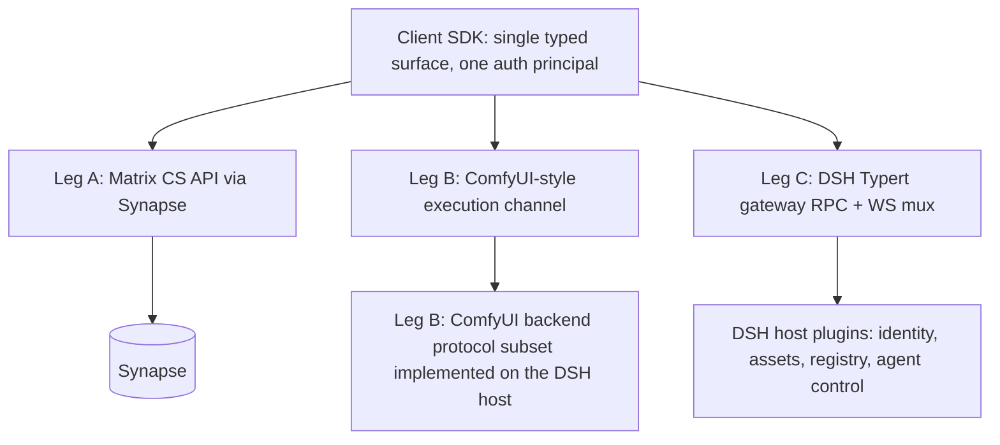

# Phase 2 Plan: Browser Client & Client–Server Communication Protocol

- Status: P2-M1 + P2-M2 + P2-M3 + P2-M4 implemented and verified (see §5 build notes); M5-M7 pending go-ahead
- Depends on: `phase1-dsh-matrix-feasibility.md` (identity plugin, chat transport plugin, DSH `movie` profile)
- Scope: unified client–server protocol, canvas strategy (ComfyUI iframe exploration), and copy-paste porting of vidsay client pages into `/home/robot/dsh_movie/client`
- Source: `/home/robot/vidsay` read-only copy-paste source; never modified

## 1. Questions answered

**Q1 — Do we need a direct client↔server channel in addition to Matrix chat?**
Yes. Matrix CS API is purpose-built for chat/rooms/media/presence and (optionally) room-scoped graph consensus, but it is a poor fit for workflow-canvas control, agent steer/stop/approval, asset-repository CRUD, registry manifests and quota/billing. Those need a direct RPC/WS channel to the DSH host. Confirmed in this plan as "Leg C".

**Q2 — Is combining Matrix/Synapse + ComfyUI protocols into one unified protocol feasible and sufficient?**
Feasible as a *composition*, **not sufficient as a literal merge**:
- Matrix contributes: identity/session, chat sync, room state/messages, media repository, presence/receipts; optionally room-scoped workflow-graph consensus (vidsay precedent: revision-gated RoomGraph commits over room events).
- ComfyUI contributes: the workflow-graph interchange shape (workflow JSON: nodes/links/widget values) and the execution-lifecycle WS envelope (status/queued/executing/progress/executed/preview) — exactly what a live workflow canvas needs.
- Sufficiency gap (neither covers): agent control, asset CRUD + lineage, registry manifest, workspace files, quota/billing, plugin status. Hence a third leg (DSH Typert gateway `@Remote` RPC + WS mux) is mandatory.
- Unification therefore happens **at the client SDK layer, not on the wire**: one typed SDK (`client/sdk`) multiplexes three legs behind a single surface, over shared contract types in `dsh_movie/protocol`, with one auth principal (the Matrix access token mapped to a DSH Peer by the Phase-1 identity plugin). Merging the wire protocols themselves would mean re-implementing Matrix sync/federation and ComfyUI execution semantics for no gain.

**Q3 — Copy-paste vidsay pages: feasible?**
Yes, per-page feasibility below (§4), each with a bounded adaptation layer. The ComfyUI-iframe canvas is an exploration track with an explicit decision gate against a Vue-Flow fallback (§3).

## 2. Protocol architecture: three legs, one SDK

- **Leg A (Matrix CS API, matrix-js-sdk in browser)**: login/whoami/refresh, room sync, messages/state, media upload + authenticated media download, presence/typing. Chat UI speaks this directly (as vidsay does today).
- **Leg B (ComfyUI-compatible)**: graph interchange = ComfyUI-style workflow JSON; live channel = WS envelope mirroring ComfyUI message types (`status`, `executing`, `progress`, `executed`, binary preview). The DSH host itself implements this protocol subset (frontend-only ComfyUI deployment — no Python server; see `phase3-comfyui-canvas-agent-scripting.md` §2). All model inference is delegated off-host over HTTPS to OpenAI-compatible providers (cloud or company GPU server), so the same envelope also proxies a real ComfyUI API worker if one is ever run on the GPU server.
- **Leg C (DSH Typert `@Remote`)**: `POST /api/<ns>/<method>` + multiplexed WS for streams; per-call Peer principal from the Matrix token (Phase-1 plugin); namespaces: `auth.*` (introspect/profile), `assets.*`, `registry.*`, `agent.*` (steer/stop/approve), `workspace.*`, `quota.*`.
  - **Implementation note (P2-M1)**: Leg C is realized as a *plugin-owned loopback HTTP+WS gateway* (`server/plugins/dsh-movie-gateway`, port 8788) rather than a native Typert `@Remote` surface — consistent with the Phase-1 finding that the DSH runtime does not expose a directly bindable `@Remote` listener to plugins. The wire contract (`POST /api/<ns>/<method>` JSON-RPC + `/api/ws` stream mux, one Matrix-token principal) is unchanged; only the server-side hosting mechanism differs. The Phase-1 identity `/auth` listener on 8787 stays intact.
- **Auth principal propagation**: browser presents the Matrix access token on Legs B/C; the identity plugin introspects (cached whoami) and maps to Peer + `@RemoteScope('user')`. No second login, no JWT of our own.

## 3. Canvas strategy: ComfyUI iframe exploration with decision gate

**Option 1 (exploration track): ComfyUI frontend in an iframe, frontend-only deployment.**
- The unmodified ComfyUI frontend build (pinned version) is served by our own host and embedded same-origin in the Studio canvas slot via `<iframe>`; the Python ComfyUI server is abandoned — our DSH host implements the minimal ComfyUI backend protocol subset (`/object_info`, `/system_stats`, `/extensions`, `/ws`, `/userdata`, no-op `/queue|/history|/prompt`); see `phase3-comfyui-canvas-agent-scripting.md` §2.
- Bridge = versioned `postMessage` contract, implemented inside the iframe by a small ComfyUI frontend extension we own: parent→iframe (`loadWorkflow`, `setNodeStatus`, `focusNode`, `setReadonly`); iframe→parent (`nodeSelected{id}`, `graphEdited{workflowJson}`, `execEvent{...}`).
- Auth into the iframe: same-origin deployment (`/comfy/` served by our host) → session cookie covers the frontend's HTTP/WS calls; no cross-origin ticket handshake needed.
- License: ComfyUI core/frontend are GPL-3.0; the iframe embeds the unmodified build served as static assets — **no ComfyUI code is vendored or copied into our bundle**, so no license contamination (verify license texts at adoption).
- Pros: mature LiteGraph editor, native execution-progress UX, zero-cost compatibility if ComfyUI becomes our image backend.
- Cons: postMessage is untyped and version-fragile; branding/styling constrained; node-click→artifact-in-stage needs the in-iframe extension; ComfyUI frontend API churn; the boot-protocol subset must be maintained against the pinned frontend version.

**Option 2 (fallback): port vidsay's Vue Flow canvas** (`pages/workspace/panels/canvas`, MIT deps) minus the toonflowNodes UMD loader; speak the same ComfyUI-style workflow JSON + Leg B envelope. Full typing/branding control.

**Decision gate (end of P2-M5)** — Option 1 adopted only if the prototype demonstrates: (a) renders our six-step group graph from workflow JSON; (b) live node status badges driven by Leg B events; (c) node click reaches the parent with node id; (d) acceptable multi-user edit-lock UX. Otherwise Option 2. The workflow-JSON interchange is shared by both options, so the canvas choice stays swappable. **→ RESULT: all four criteria passed; Option 1 ADOPTED (see §5 P2-M5 for evidence).**

## 4. Copy-paste inventory from vidsay and per-page adaptation

Common swaps (all pages): `@toonflow/i18n` → reused i18n package copy; `stores/auth.ts` → new auth store (Leg A login + Leg C introspection; delete better-auth `authClient` email-otp calls — Synapse CS API registration/password-reset/threepids replace them); `/api/matrix/token` broker → direct Synapse login (mode B), broker kept only as fallback; axios base URL → dsh_movie client config.

1. **Plaza** — `apps/web/src/pages/home/index.vue`: masonry gallery aggregated purely from `useMatrixChat` m.video messages (cover via `<video #t=0.5>`, description field, room name; click deep-links into chat). **Feasibility: high** — copy page + masonry CSS + login dialog hook; only auth-store swap.
2. **Chat page** — `apps/web/src/pages/chat/*`, `components/groupChat.vue`, `composables/useMatrixChat.ts`: entire page including Synapse chatbox, Team popover (Matrix power levels), quote-reply, media cards. **Feasibility: high** — all data flows are Matrix-native; swap token acquisition and media-proxy endpoints to Synapse authenticated media; drop Toonflow-only triggers.
3. **Studio framework (no canvas)** — `apps/web/src/pages/workspace/index.vue` + panels minus `panels/canvas`: layout, video stage/image viewer with zoom + annotation, docked chatbox, bottom toolbar. **Feasibility: medium-high** — remove canvas panel, `canvasFile.ts`, and `useRoomSpoke` canvas ops (stub `canvasCall`); reserve the canvas slot for the iframe container component (P2-M5).
4. **Account (entire page) + Settings placeholder** — `apps/web/src/pages/account/index.vue` with all its dependencies (components, composables, i18n keys): copied in full from vidsay. Only the data layer is rewired, from better-auth to Matrix CS API: display name/avatar via `/profile/{userId}/*`, password change via `/account/password`, email via threepids management, session/user-id via `whoami`; bare-localpart display convention kept. The left panel keeps the **Settings button**, but its route renders an **empty placeholder page** inside the app shell; the vidsay Settings implementation is not ported.

Explicitly NOT copied: Settings implementation (its route exists only as an empty stub), canvas panel + toonflowNodes UMD loader, `singleAgentDialog.vue`, agent panel components, plugin-market UI, pi-runtime-dependent composables.

## 5. Milestones

- **P2-M1 protocol contract + SDK skeleton** — ✅ DONE: shared contract package `dsh_movie/protocol` (typed TS catalogs for Legs B/C, workflow-JSON schema); auth-principal propagation; server-side Leg B executor stub emitting lifecycle events; Leg C `registry`/`assets` stub namespaces; client SDK package in `dsh_movie/client/sdk` importing `protocol`.
  - Build notes: root pnpm workspace unifies `protocol`, `client/sdk`, `client/web`, `client/i18n`, `server`, `server/plugins/*`. `dsh-movie-gateway` plugin generalizes the Phase-1 principal listener into one loopback HTTP+WS server on 8788 (Leg C `POST /api/<ns>/<method>` dispatcher + `/api/ws` mux; Leg B `/object_info`, `/system_stats`, no-op `/prompt|/queue|/history`, `/ws` canned lifecycle). `server/scripts/verify-gateway.ts` passes all checks against the live host: registry round-trip, `host`/`member`/`none` role gate (fail-closed), host-gated `assets/list`, invalid/missing-token rejection, Leg B lifecycle ordering, and mux data/end frames. All 8 workspace projects typecheck green; Phase-1 suites (`test:matrix`, `test:matrix-rotation`, `test:matrix-chat`, `verify:principal`, `verify:two-user`) stay green on the root workspace.
- **P2-M2 client skeleton + Chat port** — ✅ DONE: Vite + Vue3 + Element Plus app (versions pinned from vidsay `package.json`); login → rooms → text/image/video send-receive against local Synapse (SQLite).
  - Build notes: `client/web` (`@dsh-movie/web`) rebuilt as a full Vite 8 + Vue 3.5 + Element Plus app. `@toonflow/i18n` vendored to workspace member `client/i18n` (`@dsh-movie/i18n`; dev-only `extract.ts` dropped, vite plugin + transform specifiers rewritten). Two deliberate stack decisions: (1) **full Element Plus import** (`app.use(ElementPlus)` + `element-plus/global` types) instead of vidsay's unplugin auto-import, for robustness and port compatibility; (2) **client/web tsconfig uses vidsay's lighter strictness** (`strict` only, `verbatimModuleSyntax`, no `noUncheckedIndexedAccess`/`exactOptionalPropertyTypes`/`noUnusedLocals`) so the ported vidsay code compiles cleanly — this intentionally diverges from the stricter protocol/sdk/server tsconfigs. Mode-B auth store (`stores/auth.ts`) logs into Synapse directly via SDK Leg A and restores via `whoami`; settings store is self-contained localStorage (no server round-trip). Chat port copied-then-adapted: `composables/useMatrixChat.ts`, `components/groupChat.vue`, `lib/matrixMedia.ts`, `utils/textPreview.ts` — token acquisition rewired to the mode-B store, media to Synapse authenticated media (blob/objectURL), `@toonflow/i18n`→`@dsh-movie/i18n`, bot invite/lookup via `clientConfig.botUserId` (Toonflow `/api/matrix/status` + axios dropped), `@tabler/icons-vue` added for the chat toolbar icons. `pages/chat/index.vue` simplified to host `groupChat` + a lightweight media-viewer dialog (videoStage/modeSwitcher/loginDialog deferred to M3/M4). Verification: `vue-tsc` clean across all 8 projects, `pnpm --filter @dsh-movie/web build` succeeds (8292 modules), and browser E2E against live Synapse passed — login (mode B) → room list ("Movie Demo Room", Connected) → text send/receive, with the bot replying over the live pipeline. Only benign console noise: matrix-js-sdk's unstable MSC4143 RTC-transports probe 404s (endpoint not implemented by Synapse).
- **P2-M3 Plaza + Account ports** — ✅ DONE: Matrix-only data flows; i18n catalogs reused; account mutations verified against Synapse CS API; left-panel Settings button present, routing to the empty placeholder page.
  - Build notes: Plaza (`pages/plaza/index.vue`) ported from vidsay home — Matrix-only aggregation via the `useMatrixChat` singleton (`videos`/`bootstrap`/`ready`/`connecting`), masonry grid of video cards (`#t=0.5` first-frame cover), signed-out `el-empty` → `/account?login=1&redirect=/plaza` (vidsay `loginDialog` dropped for in-app routing). Account (`pages/account/index.vue`) merges vidsay's full-page sidebar layout (account/wallet/billing anchors + scroll-spy + Settings button → `/settings`) with the M2-verified **inline Mode-B login form** (replaces vidsay `loginDialog`); adds nickname + avatar edit (crop to 128px square data URI) and a change-password block; email/OTP/threepid removed. New SDK Leg A mutations (`client/sdk/src/legA.ts`): `setDisplayName` (PUT displayname), `setAvatar` (throwaway-client `uploadContent` → PUT avatar_url), `changePassword` (direct-`fetch` UIA session-replay against `/account/password`, `logout_devices:true` — implemented via fetch rather than the SDK method to satisfy the stricter `exactOptionalPropertyTypes` sdk tsconfig and matrix-js-sdk v42 typings). Auth store gained `avatarHttpUrl` (async mxc→blob resolution so `` can render authenticated media while the mxc stays in the persisted session), `updateProfile(displayName, avatarDataUri?)`, and `changePassword` (invalidates the session after device logout). Settings (`pages/settings/index.vue`) is an `el-empty` placeholder; router `/plaza` + `/settings` promoted from stubs; top nav adds Plaza + Settings. Verification: all 8 workspace projects typecheck green, `pnpm --filter @dsh-movie/web build` succeeds, and browser E2E against live Synapse passed — inline Mode-B login, display-name edit persists across reload (verified against the Synapse profile), avatar upload path wired, settings placeholder renders, plaza empty-state branch renders.
- **P2-M4 Studio framework port** — ✅ DONE: stage + docked chatbox + toolbar; empty canvas slot placeholder.
  - Build notes: Studio (`pages/studio/index.vue`) is a **new lightweight shell** rather than a port of vidsay's 801-line `workspace/index.vue` (that page is deeply coupled to canvas/document panels and host billing). Layout is a flex row: stage column (toolbar + `modeSwitcher mode="step-by-step"` + `el-empty` canvas slot "画布槽位 —— ComfyUI iframe 将在 M5 接入") | draggable `col-resize` divider | docked `groupChat embedded mode="step-by-step"`. Chat-width resize clamps to `[320px, 55vw]` with a default of `panel*2/3`. A media-viewer dialog (video/image/text) is reused from the chat page — video works via `select-video`; in `embedded` mode groupChat handles images (el-image preview) and files (download) internally, so the image/text handlers are inert-but-harmless. Deliberately omits `canvasPanel`/`documentPanel`(ProseMirror)/`useWorkspaceStore`/`useRoomSpoke`/`roomGrants`/`mcpControl`/`anonymousData`/`providerBilling`/graph-sync; the canvas slot is reserved for the M5 iframe. `components/modeSwitcher.vue` ported (`el-segmented`, one-shot↔step-by-step mask icons, carries `?room=activeRoomId`) and mounted on **both** chat (one-shot, in a new slim centered toolbar above `groupChat` so it never overlaps the room header) and studio (step-by-step) for bidirectional switching. Router `/studio` promoted from stub with `meta.requiresAuth`; top nav adds Studio. Verification: typecheck green, build succeeds, and browser E2E passed — studio shell renders the stage placeholder + docked chat + divider, and the mode switch toggles chat↔studio while preserving the same room (`?room=` propagated both directions).
- **P2-M5 ComfyUI iframe prototype + decision gate** — ✅ DONE, **gate verdict: ADOPT Option 1** (ComfyUI frontend-in-iframe). Bridge contract versioned in repo (`protocol/src/bridge.ts`, `BRIDGE_VERSION=1`).
  - Build notes: pinned ComfyUI **frontend-only** build v1.60.0 fetched via npm/network into a gitignored static dir (never vendored — GPL-safe) and served same-origin by the gateway at `/comfy/`. The DSH host implements the minimal ComfyUI backend protocol subset in `gateway-server.ts`: `/object_info` (built from the shared `MOVIE_NODES` registry via `buildObjectInfo`), `/system_stats`, `/extensions` (advertises our bridge as an **api_base-relative** URL `/extensions/dsh-movie-bridge.js`), `/jobs` (shape `{jobs:[], pagination:{total,offset,limit,has_more}}` — the frontend derives its queue from Jobs, not `/queue`), `/prompt` (drives a canned Leg B lifecycle across the six nodes), plus no-op `/queue|/history|/userdata|/settings|…`; `/ws` and `/comfy/ws` share one exec-client set. The bridge is a small ComfyUI **frontend extension we own** (`comfy-bridge/bridge-extension.js`) that registers via `app.registerExtension({name:'dsh.movie.bridge', setup(){…}})`, normalizes ComfyUI's per-event `detail` shapes into a single `nodeIdOf()` helper, paints node `boxcolor` from Leg B status, and speaks the versioned `postMessage` contract. Parent side: `composables/useCanvasBridge.ts` (handshake + `request()`/`loadWorkflow()`/`setNodeStatus()`/`setReadonly()`), `utils/demoWorkflow.ts` (builds the six-step group graph + prompt from `MOVIE_NODES`), and the Studio canvas slot (`pages/studio/index.vue`) now mounts the `<iframe>` + a canvas bar (run demo lifecycle / reload graph / toggle read-only). Vite dev proxies `/comfy` → 8788 with `ws:true`.
  - Verification: `server/scripts/verify-comfy-bridge.ts` (14 headless conformance checks) **all pass** — `/comfy/index.html` + bridge JS serve correctly, `object_info` carries all six nodes with the required `python_module` + `input.optional` fields, the extension URL resolves without a doubled `/comfy` prefix, and `POST /comfy/api/prompt` drives the full lifecycle; `verify-gateway.ts` stays green (no Leg A/C regression). All 8 workspace projects typecheck green; `pnpm --filter @dsh-movie/web build` succeeds.
  - Gate evidence (browser E2E against the live host, all four §3 criteria **PASS**): **(a)** the six-step group graph renders from workflow JSON — 6 nodes / 6 groups, types `MovieScript, MovieShotPlan, MovieAsset, MovieStoryboard, MovieClip, MovieAssemble`, WS `readyState=1`; **(b)** live node status badges from Leg B events — after "run demo lifecycle" all six nodes report status `success` painted `#2fae5f`; **(c)** node click reaches the parent with the node id — `onNodeSelected` fires, parent shows "已选中节点 #1", `selected_nodes:["1"]`; **(d)** acceptable edit-lock UX — `setReadonly(true)` sets `allow_interaction=false` + `pointerEvents:none`, node drag is blocked, and the lock releases correctly (two-client convergence is a documented single-client assessment per the §6 bridge-fragility risk note). **Recommendation: proceed with Option 1** for M6; Option 2 (Vue Flow port) remains the fallback and stays swappable because the workflow-JSON interchange is shared. Residual benign console noise (unknown `queued` message type) is cosmetic only.
- **P2-M6 workflow graph visualization** — ✅ DONE: six-step groups with live Leg B status; node click → artifact inspector in the stage; graph persistence via a **host-authoritative in-memory Leg C workflow store**. Matrix room-state consensus for multi-device convergence is **deferred to Phase 3** (documented decision; see below).
  - Build notes: new Leg C `workflow/*` namespace in `protocol/src/leg-c.ts` — `WorkflowRecord` (`{id, roomId, graph, rev, updatedAt, updatedBy}`), `workflow/get` + `workflow/put` (with optimistic-concurrency `baseRev`), a new `conflict` `ApiErrorCode`, and both methods added to `IMPLEMENTED_METHODS`. Host side: `server/plugins/dsh-movie-gateway/src/workflow-store.ts` (`createWorkflowStore()` — one room-scoped record in a `Map`, monotonic `rev`, stale `baseRev` → `conflict` carrying the current record); `gateway-server.ts` maps `conflict`→HTTP 409 and dispatches `workflow/get|put` with the **fail-closed role gate** (role `none` → `forbidden`; `host`/`member` may read+write, mirroring `assets/list`). Browser side: `composables/useWorkflowStore.ts` (Leg C persistence — `load`/`save` with `baseRev`, reactive `currentRev`, `onConflict` resync that reloads and adopts the winning graph), `composables/useExecStatus.ts` (an independent **parent-side Leg B `/ws`** socket folding `executing`/`progress`/`executed`/`execution_error`/`execution_cached` into reactive per-node status + last-output maps), and `utils/demoWorkflow.ts` gained `findMovieNode`/`nodeSchemaForId`. Studio (`pages/studio/index.vue`) now: on bridge `ready`/room change `hydrate(roomId)` loads the persisted graph (or seeds + saves the demo) into the canvas; `onGraphChanged` (already debounced 400ms in the extension) persists edits; a horizontal `.stageBody` splits the `<iframe>` and a collapsible right-side **artifact inspector** (node title, step N/6, `class_type`, output artifact type, live status badge, last `executed` output — the prototype's `{fixture:true}` renders a friendly Phase-3 placeholder); the canvas bar adds a live-socket dot + a revision badge (`rN`). Persistence uses the absolute `sdkConfig.gatewayUrl` (8788) which CORS `*` already allows in dev — no new Vite proxy.
  - Verification: `server/scripts/verify-two-user-canvas.ts` (**16 checks, all pass**) — a member `workflow/put` seeds rev 1, a host `workflow/get` converges on the same graph + last writer, a host `put` with the current `baseRev` bumps to rev 2, a stale `baseRev` → **conflict (409)**, the winning edit survives, a non-member → **forbidden** on both get and put, and the token guards (`missing-token`/`invalid-token`) + param validation (`bad-request`) hold for the new namespace. All 8 workspace projects typecheck green; `pnpm --filter @dsh-movie/web build` succeeds. Browser E2E against the live host: login → canvas ready (live dot green) → node #1 click opens the inspector (**Script · #1**, 步骤 **1 / 6**, 类型 **MovieScript**, 产物 **SCRIPT**, 状态 idle) → "run demo lifecycle" turns all six node badges green and the inspector status to success → the revision badge persists across a page reload (**r2** restored from the host store, proving the round-trip).
  - Deferred (documented, not built): **Matrix room-state consensus / multi-device CRDT convergence** and **durable on-host persistence** — the store is intentionally volatile (survives across clients + reloads, resets on a gateway restart). The host is the single graph authority for the prototype; a separate approved plan will cover consensus + durability in Phase 3.
- **P2-M7 hardening** — ✅ DONE: WS reconnect/backoff, session token re-validation, two-user E2E, and this design-doc update. **Phase 3 kickoff is teed up but NOT built here** (out of scope for Phase 2).
  - Build notes: new pure helper `client/sdk/src/backoff.ts` (capped exponential backoff with **equal jitter**, injectable `random` for deterministic tests; exported from the SDK index). `connectExecSocket` gained optional `{reconnect, maxAttempts, baseDelayMs, maxDelayMs, onReconnecting, onStatusChange}` — **default stays one-shot** so existing callers/verify scripts are unaffected; `useExecStatus` opts in with `{reconnect:true}`. `MuxSocket` now reconnects on drop (default on) and **re-sends `open` for every still-subscribed stream** (it tracks each stream's channel/params). No refresh-token flow: Synapse Mode-B uses long-lived tokens, so hardening is **re-validation**, not refresh — `stores/auth.ts` added `revalidate()` (re-runs `whoami`; on failure `invalidate()` bounces guarded routes to login; a network blip is not treated as a dead token) plus reactive `sessionValid`/`revalidating`; `App.vue` re-validates on `visibilitychange`/window-focus and a light 60s interval while signed in, surfacing a subtle `sessionDot` in the top bar. Leg C/Leg B re-read the token per call/socket, so a refreshed session propagates automatically.
  - Verification: a deterministic backoff unit check (**7/7**: 500→1000→2000→4000 growth, 15000 cap, custom base/max, equal-jitter midpoint + bounds, negative-attempt clamp). Live reconnect E2E: with the Studio page open, killing the movie-profile gateway drove the parent exec-socket dot **GREEN → RED → GREEN with no page reload** (automatic backoff reconnect), and the gateway returned to `/health` 200. `verify-gateway.ts` stays green (**24/24**) — its Leg B lifecycle collector had a pre-existing race (it resolved on the WS `execution_success` before the HTTP response assigned `prompt_id`, intermittently failing 2 prompt-id assertions); fixed by resolving only once **both** arrive, now stable across 5 consecutive runs. `verify-comfy-bridge.ts` stays green (**14/14**). All 8 workspace projects typecheck green; web build succeeds.
  - Phase 3 (deferred, separate plan): canvas agent scripting and the director pipeline teams on `ctx.subagent`/`ctx.team` (built at P3-M4). **Phase 2 is complete** with M6 + M7.

## 6. Risks and mitigations

| Risk | Mitigation |
|---|---|
| postMessage bridge untyped/version-fragile | versioned message catalog + contract e2e test; bridge extension owned by us |
| ComfyUI GPL contamination | embed via iframe only; never vendor/copy ComfyUI source |
| ComfyUI frontend API/boot-protocol churn | pin frontend build; our extension isolates the surface; boot + WS conformance tests |
| Browser Matrix sync cost with many rooms | lazy timeline loading; Plaza aggregation reuses vidsay's singleton pattern |
| vidsay client coupling to Toonflow endpoints | endpoint-swap table in §4 maintained as ports land |
| Canvas option rework | workflow-JSON interchange shared by both options; gate before commitment |
