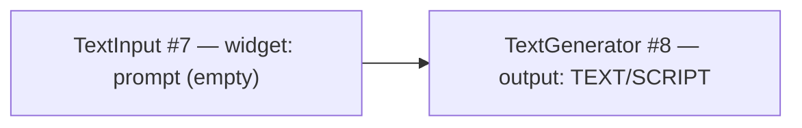
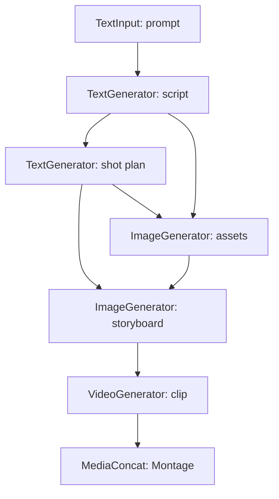

# Phase 5 Plan: Functional Node Palette + Step Macros (two-layer canvas)

- Status: 🚧 PLANNED (2026-08-09)
- Depends on: `phase4-vueflow-canvas-vidsay-shell.md`, `phase3-comfyui-canvas-agent-scripting.md` (§2/§6 node registry + executor), `phase2-client-and-protocol.md` (Leg B graph shapes)
- Scope: **protocol registry + server executor adapters + client palette/macros**. Leg A (Matrix chat), Leg C transport, P3-M5 room governance, and workspace persistence stay AS-IS. No change to the `WorkflowGraph` / `PromptGraph` wire shapes.

## 1. Goal

Replace the step-oriented node palette (`MovieScript` … `MovieAssemble`) as the *only* primitive with a **two-layer palette**:

1. **Functional primitives** — the real registry node types, organized as *role × modality*: sources (`text/image/video/audio input`), generators (`text/image/video/audio generator`), reviewers (`text/image/video/audio reviewer`), and combiners (`text merge`, `media concat`, `save/preview`).
2. **Step macros (templates)** — the six movie steps survive as pre-wired *templates* that expand, at drop time, into a functional subgraph. The one-click pipeline (一键生成) becomes "expand the full pipeline template".

Motivation (design discussion, 2026-08-09):

- Step nodes conflate *capability* with *pipeline position*, so ad-hoc graphs are inexpressible (e.g. raw image + edit request → image generator), branches/alternatives/QC have no home, and ComfyUI community nodes cannot fit a movie-step taxonomy.
- Functional nodes make the **typed media slot system** the contract, move step identity into the prompt/skill layer, and collapse six bespoke step handlers into ~one adapter per modality.
- The graph engine (validate → Kahn topo → runner → WS lifecycle) is already class-type-agnostic, so the palette change is registry data + node adapters, not engine surgery.

## 2. Current state (what exists today)

- `protocol/src/nodes.ts` — `MOVIE_NODES`: six `MovieNodeSchema` entries (`classType`, `displayName`, `description`, `category`, `step`, `inputs[]`, `outputs[]`, `widgets[]`, `outputNode?`), slot types `SCRIPT | SHOT_PLAN | ASSET | STORYBOARD | CLIP | MOVIE`, and `buildObjectInfo()` rendering the ComfyUI `/object_info` catalog.
- `server/.../movie-executor/registry.ts` — merges `buildObjectInfo()` with `CANNED_OBJECT_INFO` from `fixtures.ts`; the canned set already contains **functional** nodes (`MovieTextToImage` → `IMAGE`, `MovieImageToVideo` → `VIDEO`, `MovieSaveOutput`), i.e. the functional family already exists as demo stubs.
- `server/.../movie-executor/validate.ts` — validates `class_type` against the catalog and link slot *ranges*; it does **not** check link slot *type* compatibility (gap this phase closes).
- `server/.../movie-executor/topo.ts` + `runner.ts` — Kahn sort over link tuples; the runner's only per-node branch is `TEXT_STEPS = {MovieScript, MovieShotPlan}` → `StepTextGenerator`, everything else → `MediaProvider.generate(classType, inputs)`.
- Client — `pages/studio/index.vue` "添加节点" dropdown over `MOVIE_NODES`; `canvas/MovieNode.vue` generic data-driven node; `utils/demoWorkflow.ts` builds the six-node demo graph with cosmetic groups; `movie-team/director.ts` drives the chat-path pipeline with its own hardcoded step prompts.
- `canvas-agent.ts` — per-room serialized canvas planner (`CanvasScriptAgent`): intent → constrained op-script over `CANVAS_OP_TYPES`, prompted with the node catalog, the op catalog, and a projection of the **current graph** (rules: reuse existing ids, emit only the ops the intent requires); failed postconditions roll the txn back and drive a corrective re-plan (`op-script-validator.ts` server-side, `useCanvasScript.ts` client-side).

## 3. Decisions D1–D14

### D1 — Two-layer palette in ONE plugin: primitives as registry data, steps as templates, adapters as modules
**Palette layering.** The registry (`protocol/src/nodes.ts`) gains the functional catalog as first-class `class_type`s. The six step class types are **retained for one phase as deprecated, still-executable aliases** (persisted rooms' `WorkflowGraph`s and `demoWorkflow.ts` reference them) and are removed in Phase 6. Templates (D6) are the forward path; deprecation is announced via `ObjectInfoEntry.deprecated = true` on the step entries.

**Plugin topology.** All first-party execution lives in **one plugin** (`dsh-movie-gateway`): node classes are registry *data*, execution semantics are adapter *modules* per family/modality (D4). A Cordis plugin boundary buys independent lifecycle, an RPC/config namespace, and ownership/replaceability — it does **not** buy process isolation, independent scaling, or concurrency (all plugins of a profile run in one host process; a graph run is one sequential job). The split criterion is therefore *difference in lifecycle, dependency weight, or ownership*, never class count. Rejected alternatives: **plugin-per-class (16)** — sixteen lifecycles/configs and a registry-aggregation problem coordinating nothing, since a run has no peer negotiation (one job walks topo order resolving links); **plugin-per-step** (`script`…`montage`) — the wrong axis, re-hardcoding pipeline position and leaving ad-hoc graphs, branches, and extra reviewers without a home. Multi-plugin cooperation itself is proven and normal (the host already runs `dsh-matrix-identity` + gateway + base services concurrently); it is simply unnecessary at node-class granularity.

**Extensibility without proliferation.** The executor exposes a **handler-registry service contract** (the pattern DSH's skill subsystem uses: a registry plus providers registering at activation): adapters register `classType → handler`, and any *future* plugin — a GPU-backed media provider, a community node pack — may register additional handlers without modifying the gateway. Genuine future splits stay on the concern axis: a **media-provider plugin** when real backends bring heavy SDKs/GPU hosts/separate billing, and a **planner plugin** if the control-plane agent (D7) outgrows a module.

### D2 — Typed media slot system with subtyping
Base media types: `TEXT`, `IMAGE`, `VIDEO`, `AUDIO` (sound and music are `AUDIO` distinguished by a widget, not a slot type). The existing step artifact types become **subtypes of `TEXT`/`IMAGE`/…**: `SCRIPT`, `SHOT_PLAN` ⊂ `TEXT`; `ASSET`, `STORYBOARD` ⊂ `IMAGE`; `CLIP`, `MOVIE` ⊂ `VIDEO`. A static `SUBTYPE_OF` table in the protocol defines assignability (a `SCRIPT` output may feed a `TEXT` input; a `TEXT` output may **not** feed a `SCRIPT` input unless the consumer declares `TEXT`). `validate.ts` gains a link type-compatibility check using it (today only slot-range is checked), reported in the existing ComfyUI `node_errors` shape.

### D3 — Node families and naming
Every schema carries `family: 'source' | 'generator' | 'reviewer' | 'combiner'` and `modality: 'text' | 'image' | 'video' | 'audio'`. Class types (all under pseudo-module `dsh_movie.movie_nodes`):

| family | class types |
|---|---|
| source | `TextInput`, `ImageInput`, `VideoInput`, `AudioInput` |
| generator | `TextGenerator`, `ImageGenerator`, `VideoGenerator`, `AudioGenerator` |
| reviewer | `TextReviewer`, `ImageReviewer`, `VideoReviewer`, `AudioReviewer` |
| combiner | `TextMerge`, `MediaConcat`, `SaveOutput` |

Widgets carry the intra-family variation: `AudioGenerator.kind ∈ {sound, music}`; `ImageGenerator.mode ∈ {text_to_image, image_to_image}` (the latter requires a linked `IMAGE` input); `VideoGenerator.mode ∈ {text_to_video, image_to_video}`. Sources expose their payload as a widget (multiline text / uploaded asset reference) and one typed output.

The catalog is exactly these **15 classes**. A 16th candidate, `IntentAnalyzer` (router), is **excluded**: its input is the Leg A conversation and its output is an intent/op-script, not a slot artifact — it is control-plane, not dataflow (D7).

### D4 — Execution dispatch by family, one adapter per modality
`runner.ts`'s `TEXT_STEPS` special case is replaced by a **family dispatch table** resolved from the registry entry:

- `source` → pass-through: widget payload becomes the node output artifact.
- `generator/text` → LLM adapter (the existing `StepTextGenerator` seam generalized); prompt assembled from resolved inputs (linked texts as ordered sections, linked media as referenced artifacts) + widget text.
- `generator/image|video|audio` → modality adapter behind the existing `MediaProvider` interface, one implementation per modality, each with a canned fallback so runs complete without model keys (mirrors today's behavior).
- `reviewer` → judge adapter: an LLM call given the reviewed artifact + review criteria widget; emits a verdict (D5).
- `combiner` → pure function (concat/merge/save), no model call.

Adapters read model endpoints from server settings (Bailian), exactly as the current text generator does. The per-node lifecycle broadcast (`executing → progress → executed`) is unchanged.

### D5 — Reviewers emit verdicts; no loops in the DAG
A reviewer's outputs are `VERDICT` (a `TEXT` subtype: pass/fail + notes) and, on pass, the reviewed artifact forwarded unchanged. Because a DAG cannot loop, **fail does not retry automatically**: retry is a manual re-run or a director-driven re-run over chat. Conditional/switch nodes are explicitly out of scope (§9). Reviewers therefore add QC visibility without adding control flow to the engine.

### D6 — Templates expand client-side at drop time; the server never sees macros
Template definitions live in the protocol (`protocol/src/templates.ts`): `{ id, displayName, nodes: functional subgraph, links, widgetOverrides, layout }`. The client palette is a family→class **cascade** (D12) whose fifth branch holds these templates, and dropping one expands it into fresh node ids in the Vue Flow store (`canvas/expandTemplate.ts`). The one-click pipeline button expands the `movie-pipeline` template. Consequence: the persisted `WorkflowGraph` and the submitted `PromptGraph` always contain **expanded functional nodes only** — WYSIWYG, no server macro code, no governance/persistence changes. Server-side expansion was rejected (it would make the persisted graph differ from what the user sees).

**What a template drop delivers — worked example.** Only ordinary nodes + links + widget defaults, pasted at the drop point with fresh ids; no macro node, no collapsed box, no server-side object. After the drop the inserted nodes are indistinguishable from hand-placed ones (rewire, edit, delete, branch freely). Cascade → **Templates → Script** drops a pre-wired pair:

The 一键生成 button (shortcut for `movie-pipeline`) drops the full chain, pre-wired with sensible widget defaults — today's six-step demo graph re-expressed in functional nodes, inserted in one click and then fully editable:

**Why the user needs it.** (i) The target user is a layman: hand-building that chain means ~8 nodes and ~9 type-correct links (D2 rejects mismatches); templates are the "New from template" of a document editor. (ii) D11 removes auto-seeding, so templates are what preserves today's one-click experience. (iii) Known-good wiring, widget defaults, and layout are encoded once instead of re-derived per user or per planner turn. (iv) Experts use templates as starting points, then customize (delete a step, fork a branch, wire an extra `ImageInput`).

**What a template is *not*.** Not a node (nothing named "template" exists on the canvas or in `PromptGraph`; expansion is eager at drop time); not server-visible (the gateway receives only expanded functional nodes, so validation/topo/runner/governance never learn templates exist); not collapsible or re-editable as a unit (no collapse state, no "edit the macro updates all instances" semantics) — deliberately, so the persisted graph stays WYSIWYG: what you see is exactly what runs. Mental model: families/classes are the alphabet, templates are pre-written sentences, the conversation (D7) is the editor that revises them.

### D7 — Conversation → graph: incremental op-scripts, never regeneration
The existing per-room canvas planner (`canvas-agent.ts`) already emits *patches*: its prompt carries the current graph plus rules to reuse node ids and emit only the ops the intent requires, and failed postconditions roll the txn back and drive a corrective re-plan. Phase 5 completes the loop: `customer_service` mines the room conversation for graph-edit intents (a cheap router model decides which utterances qualify; content discussion never triggers ops), distills each into an intent, and invokes the planner. Zigzag revision is therefore a sequence of small validated txns against the live graph — manual edits, positions, and ids survive because agent ops and user ops flow through the same txn/postcondition/undo pipeline. Whole-graph regeneration per turn is explicitly rejected (it would destroy manual work every turn).

### D8 — Artifacts are triple-addressable and echoed to the room
Every generator/reviewer output must exist in three addressable forms: a **Leg A media event** (display + annotate in the Chat stage), an **asset-store entry** (referenceable as a source-node payload, e.g. an annotated screenshot → image message → asset id → `ImageInput` widget), and an **executed-output artifact** (graph side). Consequently canvas-path runs echo each `executed` artifact into the room exactly as director-driven chat runs do, so the Chat page always shows the immediate representation of each step no matter which page triggered the run.

### D9 — Chat ⇄ graph synchronization is convergence, not mirroring
Two sources of truth, one event stream: the server-authoritative `WorkflowGraph` (Leg C) and the room timeline (Leg A), both projected through the gateway WS mux that Chat and Studio already share (one room across the mode switch). chat → graph travels as op-scripts (D7); graph → chat travels as artifact echoes (D8) plus **one batched, collapsible narration system message per committed txn** (`+ ImageGenerator #7; edge #3→#7`). Per-keystroke or per-op mirroring is rejected: the conversation stays the audit log, the graph stays the executable projection of current intent.

### D10 — The final step is named "Montage" in display only
Film-correct (assembly of shots into a sequence) and unambiguous in Chinese (蒙太奇), but "montage" elsewhere can mean photomontage (compositing images into one frame) — a different operation from concatenating clips in time. Disambiguate by layer: technical identifiers stay `MediaConcat` (functional combiner) and `MovieAssemble` (deprecated step alias), while the template step and node **displayName become "Montage"** (optionally "Montage · Final Cut"). Names live in display/template data, never in `class_type`, so persisted graphs stay stable.

### D11 — Studio opens on an empty canvas; nothing is seeded
Today `hydrate()` loads `buildDemoWorkflow()` for empty rooms (and the host seeds it as revision 1). Phase 5 removes auto-seeding: a fresh room opens on an **empty canvas** with a hint pointing at the Add-node cascade; `demoWorkflow.ts` survives only as a template/verifier fixture. Rationale: the graph must always be the executable projection of *this* room's conversation (D9); pre-seeded pipeline nodes misrepresent intent and invite runs nobody asked for. Existing rooms keep their persisted graphs unchanged.

### D12 — Add-node is a family → class cascade
The palette is a two-level cascade: level 1 = the four families (`source`, `generator`, `reviewer`, `combiner`) plus a fifth **Templates** branch holding the D6 step templates; level 2 = the class types of the picked family (e.g. `source` → `TextInput` / `ImageInput` / `VideoInput` / `AudioInput`). Each level-2 entry shows its **slot signature** (e.g. `IMAGE → IMAGE`) so wiring is predictable. The empty-canvas quick-create overlay opens the same cascade; host-only gating is unchanged. This replaces the flat six-step dropdown.

### D13 — Group nodes: one-shot rectangle draw, aesthetic-only, persisted
The 分组节点 button **arms** a single rectangle draw: pointer-drag on the canvas background creates one `WorkflowGroup` (`{title, bounding, color}`) and disarms; a second rectangle requires re-arming. Clicking a group rectangle opens a popover to rename it and pick its background color. Groups render as an **under-node overlay layer** (Vue Flow has no group primitive); nodes are never children of a group. Groups serialize into `WorkflowGraph.groups` (already in the wire schema) and are ignored by validation/topo/runner — aesthetic bookkeeping only.

### D14 — Move canvas is one-shot, not a toggle
The 移动画布 button arms hand mode for **one** pan gesture and disarms on the gesture's pointerup; moving again requires re-clicking (today it is a sticky toggle). Same arm/disarm interaction model as D13, so the two tools behave consistently.

## 4. Protocol changes (`protocol/src/`)

- `nodes.ts`: add `family` + `modality` to `MovieNodeSchema`; add `FUNCTIONAL_NODES` catalog (D3 table); add `MEDIA_SLOT_TYPES`, `SUBTYPE_OF`, and `slotCompatible(sourceType, targetType)`; mark the six step entries `deprecated: true` (D1); `buildObjectInfo` renders both catalogs unchanged in shape.
- `templates.ts` (new): the six single-step templates (`step-script` … `step-assemble`, each a 1–3 node functional subgraph reproducing today's step semantics) + `movie-pipeline` (their composition). Templates reference functional class types only. The pipeline's last step carries displayName **Montage** (D10); class types stay technical.
- Wire shapes (`leg-b.ts` `WorkflowGraph` / `PromptGraph`) unchanged; `PromptGraphNode` gains no fields (family/modality are looked up server-side from the catalog).

## 5. Server changes (`server/plugins/dsh-movie-gateway/src/movie-executor/`)

- `registry.ts`: merge `FUNCTIONAL_NODES` into the catalog (movie/functional entries win over canned on collision; canned set kept so `verify-comfy-bridge` stays green). It also exposes the **handler-registry service contract** (D1): adapters register `classType → handler` at activation, so a future plugin can contribute handlers without touching the gateway.
- `validate.ts`: add the D2 link type-compatibility check via `slotCompatible`; errors keyed per node in the existing `node_errors` shape.
- `runner.ts`: replace `TEXT_STEPS`/`isTextStep` with the D4 family dispatch; add input-resolution → prompt-assembly helper (ordered linked texts, media artifact references, widget values) shared by the text and reviewer adapters.
- `adapters/` (new): `llm-text.ts` (generalizes `StepTextGenerator`), `image.ts`, `video.ts`, `audio.ts`, `reviewer.ts`, `combiner.ts`, `source.ts`; each implements the `MediaProvider`-shaped seam with canned fallback.
- `movie-team/director.ts`: chat-path orchestration unchanged; its text steps call the generalized text adapter (skill-embedded prompts arrive with the skill-template phase, cross-referenced, not here).
- Executed-output payload gains `modality` so the client inspector can render it (additive field).
- **Artifact echo (D8):** every `executed` output is posted to the room as a Leg A media/text message (as the director's chat-path runs already do), so the Chat stage shows each step's immediate representation regardless of which page triggered the run.
- **Txn narration (D9):** on each committed op-script txn the gateway posts one batched, collapsible system message summarizing the ops (`+ ImageGenerator #7; edge #3→#7`); no per-keystroke mirroring.
- **Intent mining (D7):** `customer_service` distills graph-edit intents from the room conversation (cheap router model) and invokes the canvas planner; ordinary content discussion never triggers ops.

## 6. Client changes (`client/web/src/`)

- `Chat` page: **no visual component changes** — D8 artifact echoes arrive as ordinary media/text messages the existing stage/media viewer already renders.
- `pages/studio/index.vue`: `hydrate()` applies an **empty graph** for fresh rooms (no demo seed, D11); the flat six-step dropdown becomes the family→class **cascade** with a Templates branch (D12); 分组节点 arms one rectangle draw (D13); 移动画布 arms one pan gesture (D14); the 一键生成 button expands `movie-pipeline` (D6).
- `canvas/expandTemplate.ts` (new): instantiates a template at a canvas position with fresh numeric ids (reuses the bridge's `nextNodeId`), wires internal links, applies `widgetOverrides`.
- `canvas/groupOverlay.ts` (new): under-node rectangle layer rendering `WorkflowGraph.groups`, pointer-drag creation while armed, click → rename/recolor popover; serialized on export via `graphMapper.ts` (today export only preserves `base.groups`).
- `canvas/MovieNode.vue`: family icon/badge + modality-colored slot handles (color table from `MEDIA_SLOT_TYPES`); reviewer nodes render the verdict line; source nodes render their payload widget prominently.
- `utils/demoWorkflow.ts`: no longer auto-loaded on hydrate (D11); retained as the template/verifier fixture and rebuilt on functional nodes (image input + text input → image generator, plus the pipeline template) so it exercises a non-linear join.
- Studio artifact inspector: modality renderers (text view, image view, video view, **audio player** for `AUDIO`).
- `groupChat.vue` timeline renders txn-narration system messages as collapsible entries (D9); template/step display names show **Montage** for the final assembly (D10).
- `graphMapper.ts` gains group serialization for drawn groups (D13); `useVueFlowBridge.ts` and the op-script catalog are otherwise **unchanged** (already slot-index based).

## 7. Milestones

- **P5-M0 — Protocol registry v2.** `nodes.ts` family/modality + functional catalog + slot-type system; `templates.ts`. Acceptance: `pnpm -r --if-present typecheck` green; `buildObjectInfo()` advertises all functional class types; new pure verifier `server/scripts/verify-node-registry.ts` asserts catalog completeness, subtype table acyclicity, and template referential integrity (every template class type + slot link exists and type-checks); the catalog contains exactly the 15 functional classes (no router class); the pipeline's last step displayName is `Montage`.
- **P5-M1 — Server dispatch + validation.** `validate.ts` type-compat; `runner.ts` family dispatch with canned adapters. Acceptance: `verify-movie-executor.ts` extended with a join graph (image input + text input → image generator) and a fork graph, both executing in topo order; a mismatched-type link is rejected with `node_errors`; `verify-comfy-bridge.ts` and `verify-canvas-scale.ts` stay green.
- **P5-M2 — Real modality adapters.** Bailian-backed text adapter; image/video/audio adapters behind settings with canned fallback when keys absent. Acceptance: a functional 3-node graph produces a real text artifact and (with keys) a real image; without keys the canned path completes and the job settles `completed`; executed artifacts are echoed into the room (D8).
- **P5-M3 — Client palette + macros + Studio interaction model.** Cascade palette (D12), `expandTemplate.ts`, group overlay + one-shot tools (D13/D14), empty initial canvas (D11), node UI badges/slot colors. Acceptance: browser E2E — a fresh room opens on an empty canvas; cascade `source → ImageInput` + `source → TextInput` + `generator → ImageGenerator` drop, wire, run, badges paint per node; one group rectangle is drawn, renamed and recolored, and survives a room reload; 移动画布 disarms after a single pan; dropping the "Script" template yields a subgraph matching `step-script`.
- **P5-M4 — Reviewers + combiners + pipeline parity.** Reviewer/combiner adapters + verdict UI + audio player; `movie-pipeline` template reproduces the old six-step run end-to-end. Acceptance: one-click run on the expanded template yields the same artifact sequence as the pre-Phase-5 pipeline (`verify-movie-pipeline.ts` green against both); a reviewer fail shows the verdict and does not block unrelated branches; a chat turn distilled by `customer_service` patches the graph via op-script (D7) and the commit is narrated once in the timeline (D9).
- **P5-M5 — Deprecation + docs.** Step class types flagged deprecated in `/object_info`; load-time notice for persisted graphs still using them (they remain executable this phase); `doc/architecture.md` §8 updated to describe the two-layer palette and the family dispatch.

## 8. Verification strategy

- Static: `pnpm -r --if-present typecheck` (8 workspace projects) + `client/web` production build.
- Pure: `verify-node-registry.ts` (new, M0).
- Live-gateway: `verify-movie-executor.ts`, `verify-comfy-bridge.ts`, `verify-canvas-scale.ts`, `verify-movie-pipeline.ts`, `verify-gateway.ts` (unchanged legs must stay green throughout).
- Browser E2E (M3/M4): join-graph run, template drop parity, one-click pipeline parity, reviewer verdict paint.

## 9. Out of scope

- Conditional / switch nodes and any loop-back (retry) semantics — a DAG stays a DAG; auto-retry is a director/chat concern.
- Proxying arbitrary ComfyUI community nodes (the registry stays a closed, curated catalog; community support is a later phase).
- Server-side macro expansion (D6 rejects it).
- The skill-template system (skill retrieval/embedding for generator prompts) — separate phase; P5 only ensures the text adapter has a prompt-injection seam for it.
- Removing the six step class types (Phase 6, after one phase of deprecation).
- Plugin-per-node-class and plugin-per-step decompositions (D1); pub/sub as a dataflow coordination mechanism (links/slots remain the dataflow contract; events carry lifecycle only).
- `IntentAnalyzer` as an execution node class (control-plane only, D7).

## 10. Risks

- **R1 — Persisted-graph compatibility.** Rooms' drafts contain step class types; mitigated by D1 (deprecated but executable for one phase) and load-time notice.
- **R2 — Slot-type migration.** Introducing subtyping changes which links validate; mitigated by `SUBTYPE_OF` covering all six legacy types as subtypes, so every previously-valid link stays valid.
- **R3 — Model keys/quota.** Real image/video/audio adapters depend on Bailian endpoints; mitigated by canned fallback per adapter (today's behavior) and settings-gated activation.
- **R4 — Template/director drift.** The chat path (director) and the canvas path (templates) must produce equivalent pipelines; mitigated by M4 parity verification and by sourcing both from the same functional catalog.
- **R5 — Intent-mining false positives.** A misread utterance could patch the graph; mitigated by router confidence gating, txn postconditions, and unified undo (agent and user ops share one history).
- **R6 — Narration noise.** Mitigated by one batched collapsible system message per txn (D9), never per-op or per-keystroke.
